# Desempenho operacional da maquinaria agrícola
<hr>

## Desempenho operacional da maquinaria agrícola
<hr>

Estudo analítico das operações, a fim de determinar "o que fazer" e "quando fazer", por meio da análise operacional.


::: {.fragment}

Para obter uma mecanização "racional", deve-se seguir três planos.

::: {.incremental}

- Inicialmente, definimos a operação (o que fazer);
- Depois, escolhemos os métodos e as máquinas (como fazer);
- Por fim, temos a execução da operação (fazer).

:::
:::

## Desempenho operacional da maquinaria agrícola
<hr>

O desempenho operacional é definido como um complexo de informações para definir quali-quantitativamente os atributos da maquinaria agrícola quando executa operações sob determinadas condições de trabalho.

::: {.incremental}

- Características operacionais: abrangem dados relativos à qualidade e à quantidade de trabalho desenvolvido pela maquinaria, sob determinadas condições de trabalho;
- Características dinâmicas: abrangem dados de potência requerida para acionamento e de velocidade de trabalho da maquinaria, sob determinadas condições de trabalho;
- Características de manejo: relacionadas às regulagens, à manutenção, às reparações e à estabilidade.


:::

# Terminologias para a análise de sistemas mecanizados
<hr>

## Terminologias para a análise de sistemas mecanizados
<hr>

::: {.incremental}

- Tempo de campo;
  - É o tempo que a máquina utiliza no campo, desde o início da atividade funcional até o término dela.
- Tempo teórico por unidade de área;
  - É o tempo que seria requerido trabalhando-se na capacidade de campo teórica;
- Tempo operacional efetivo;
  - É o tempo durante o qual a máquina está realmente desempenhando a função para a qual foi projetada. É maior que o tempo teórico de campo se a largura total útil da máquina não for utilizada.

:::

## Terminologias para a análise de sistemas mecanizados
<hr>

::: {.incremental}

- Tempo total de campo;
  - É a soma do tempo operacional efetivo com os tempos perdidos;
- Tempos perdidos;
  - Podem advir de obstruções no campo (embuchamento), abastecimento (combustível e insumos), descarga de produto, manutenção e manobras (o deslocamento de ida e volta ao campo, a manutenção preventiva e a verificação diária não são contabilizados);
  - Tempos perdidos por confiabilidade das máquinas: probabilidade estatística de que um equipamento desempenhe bem sua função por um período de tempo (relacionado com quebras).

:::

## Terminologias para a análise de sistemas mecanizados
<hr>

::: {.incremental}

- Capacidade de campo;
  - Efetiva (Ce): é a razão entre o desempenho atual (área) em um tempo dado; 
    - $Ce=\frac{área~(ha)}{tempo~(h)}$;
  - Teórica (Ct): é a razão de desempenho obtida se a máquina trabalhar 100% do tempo na velocidade nominal, utilizando 100% de sua largura nominal;
    - $Ct=largura~(m)*velocidade~(m/h)$

:::

## Terminologias para a análise de sistemas mecanizados
<hr>

Eficiência de campo: é a razão entre a capacidade de campo efetiva e a capacidade de campo teórica.

::: {.fragment}

$$Efc=\frac{Ce}{Ct}=\frac{Te}{Tc}$$

onde,

- $Te$ Tempo efetivo (gasto na operação de fato);
- $Tc$ Tempo total no campo (contando as perdas).

:::

## Terminologias para a análise de sistemas mecanizados
<hr>

Eficiência de tempo: é a razão entre o tempo efetivo e o tempo total de campo.


::: {.fragment}


$$Eft=\frac{Te}{Tc}$$

onde,

- $Te$ Tempo efetivo por unidade de área;
- $Tc$ Tempo total de campo;


:::

## Terminologias para a análise de sistemas mecanizados
<hr>

O tempo total de campo pode ser descrito como:

$$Tc=Te+Tpn+Tpp$$


- $Tpn$ Tempo perdido não proporcional à área;
- $Tpp$ Tempo perdido proporcional à área;
- $Te$ Tempo efetivo por unidade de área;
- $Tc$ Tempo total de campo;

## Terminologias para a análise de sistemas mecanizados
<hr>

::: {.incremental}

- Velocidade de trabalho: é a razão média de deslocamento de uma máquina no campo durante um período ininterrupto de atividade funcional;
- Fator de carga: é a razão entre a potência utilizada na execução de uma operação no campo e a potência líquida disponível no motor;
- Largura de trabalho;
  - Efetiva é a largura com a qual a máquina efetivamente opera;
  - Teórica é a largura obtida com a medida da parte operacional da máquina;

:::

## Desempenho
<hr>

A determinação das eficiências de campo das máquinas envolve o estudo dos tempos e movimentos em cada situação de trabalho da máquina de interesse.


::: {.fragment}

Uma das formas é determinar as eficiências de campo levantando esses dados por alguns dias.

:::

## Exemplo
<hr>


Dados de ensaio de uma colhedora de arroz, com os seguintes valores:

::: {.columns}

::: {.column}

- Área trabalhada: 0,37 ha;
- Largura de trabalho: 3,64 m;
- Tempo efetivo de colheita: 21,76 min;
- Tempo de manobras: 5,89 min;
- Velocidade: 2,8 km/h;
- Tempo de descarregamento: 4,42 min;
- Tempo total de campo: Te + Tp;

:::

::: {.column}


Encontre:

- Capacidade de campo teórica;
- Capacidade de campo efetiva;
- Eficiência de campo;
- Eficiência de campo por tempo;
- Capacidade de manipulação;

:::

:::

## Eficiência de campo em operações
<hr>

::: {#tbl-velocidades style="font-size:24px"}
| **Equipamento** | **Velocidade (km h⁻¹)** | **EC (%)** |
|:---|:---:|:---:|
| Arados | 4–8 | 70–85 |
| Grades pesadas | 5–7 | 70–90 |
| Grades niveladoras | 7–9 | 70–90 |
| Escarificadores | 5–8 | 70–85 |
| Subsoladores | 4–7 | 70–90 |
| Enxadas rotativas | 2–7 | 70–90 |
| Semeadoras de sementes miúdas | 4–8 | 65–80 |
| **Semeadoras de sementes graúdas (precisão)** | | |
| &nbsp;&nbsp;Plantio direto | 3–7 | 50–75 |
| &nbsp;&nbsp;Plantio convencional | 4–8 | 50–75 |
| Cultivadores | 3–5 | 70–90 |
| Pulverizadores | 5–8 | 60–75 |
| Colhedora de arrasto | 3–6 | 60–75 |
| Colhedora combinada automotriz | 3–6 | 65–80 |
| Colhedora de forragem | 4–7 | 50–75 |
| Ceifadoras | 6–9 | 75–85 |

*Fonte: Balastreire (1990).*
:::


## Exercício 1 - Colhedora de soja
<hr>

```{r}
library(countdown)

countdown(
  minutes = 5,
  seconds = 0,
  right = 0,
  top = 0,
  padding = "5px",
  margin = "0%",
)
```


::: {.columns}

::: {.column}

- Área trabalhada: 0,78 ha;
- Largura de trabalho: 5,0 m;
- Velocidade: 4,0 km/h;
- Tempo efetivo de colheita: 24 min;
- Tempo de manobras: 6 min;
- Tempo de descarregamento: 5 min;
- Produtividade da lavoura: 3.600 kg/ha;
- Tempo total de campo: Te + Tp;

:::

::: {.column}

Encontre:

- Capacidade de campo teórica;
- Capacidade de campo efetiva;
- Eficiência de campo;
- Eficiência de campo por tempo;
- Capacidade de manipulação (t/h);

:::

:::

## Exercício 2 - Semeadora
<hr>

```{r}
library(countdown)

countdown(
  minutes = 5,
  seconds = 0,
  right = 0,
  top = 0,
  padding = "5px",
  margin = "0%",
)
```

::: {.columns}

::: {.column}

- Área semeada: 2,40 ha;
- Largura de trabalho: 4,5 m;
- Velocidade: 5,5 km/h;
- Tempo efetivo de semeadura: 58 min;
- Tempo de manobras: 14 min;
- Tempo de abastecimento: 12 min;
- Dose de sementes: 60 kg/ha;

:::

::: {.column}

Encontre:

- Capacidade de campo teórica;
- Capacidade de campo efetiva;
- Eficiência de campo;
- Eficiência de campo por tempo;
- Capacidade de manipulação (kg/h de sementes);

:::

:::

## Exercício 3 - Pulverizador autopropelido
<hr>

```{r}
library(countdown)

countdown(
  minutes = 5,
  seconds = 0,
  right = 0,
  top = 0,
  padding = "5px",
  margin = "0%",
)
```

::: {.columns}

::: {.column}

- Área pulverizada: 12,0 ha;
- Largura da barra: 18 m;
- Velocidade: 7 km/h;
- Tempo efetivo de aplicação: 60 min;
- Tempo de manobras: 8 min;
- Tempo de reabastecimento do tanque: 20 min;
- Taxa de aplicação: 100 L/ha;

:::

::: {.column}

Encontre:

- Capacidade de campo teórica;
- Capacidade de campo efetiva;
- Eficiência de campo;
- Eficiência de campo por tempo;
- Capacidade de manipulação (L/h de calda);


:::

:::

## Exercício 4 - Colheita de milho
<hr>

```{r}
library(countdown)

countdown(
  minutes = 5,
  seconds = 0,
  right = 0,
  top = 0,
  padding = "5px",
  margin = "0%",
)
```


Uma colhedora de milho tem capacidade de campo teórica de 3,0 ha/h e eficiência de campo de 70%. A produtividade esperada é de 12.000 kg/ha e a área total a ser colhida é de 45 ha.

Encontre:

- Capacidade de campo efetiva;
- Capacidade de manipulação (t/h);
- Tempo total necessário para colher a área;
- Quantos dias de 8 h de trabalho serão necessários;


# Máquinas para preparo do solo
<hr>

## Máquinas para preparo do solo
<hr>

>Quando as condições naturais são adequadas, não é preciso intervir no solo para assegurar o desenvolvimento saudável das plantas. Isso justifica por que, na ausência de interferência humana, várias espécies de plantas conseguem prosperar em equilíbrio biológico na natureza.


::: {.fragment}

> Por outro lado, na ausência dessas condições, o preparo do solo torna-se uma operação fundamental na agricultura, abrangendo uma variedade de métodos e gerando diferentes perspectivas.

:::

## Máquinas para preparo do solo
<hr>

[__O que é o preparo do solo?__]{.fg style="--col: #e64173"}

::: {.fragment}

Engloba uma série de atividades que envolvem a movimentação do solo, com o objetivo de estabelecer condições propícias para o desenvolvimento das culturas.

:::


::: {.fragment}


Trata-se da manipulação mecânica do solo por meio da ação dos órgãos ativos das máquinas e dos implementos agrícolas.

:::

## Máquinas para preparo do solo
<hr>

[__Origem e história__]{.fg style="--col: #e64173"}

O preparo do solo surgiu quando o homem deixou de depender exclusivamente da caça, da pesca e da coleta e passou a cultivar o solo.


::: {.fragment}

Os registros históricos indicam que o preparo do solo teve início por volta de 2000 anos antes de Cristo, na região da Mesopotâmia.

:::


::: {.fragment}

Com o tempo, o homem começou a utilizar animais para tracionar hastes de madeira e, depois, de metal.

:::


::: {.fragment}

Em 1760, na Escócia, foi introduzido o arado com aivecas de metal, tornando-se, assim, um dos implementos mais antigos e amplamente utilizados no preparo do solo.

:::

## Máquinas para preparo do solo
<hr>

[__Origem e história__]{.fg style="--col: #e64173"}

::: {.fragment}

Até os anos de 1960, a principal prática de preparo do solo era a aração, enquanto a gradagem tinha função secundária de destorroamento e nivelamento.

:::


::: {.fragment}

A partir de 1970, houve considerável redução no uso do arado, e a grade passou a assumir um papel crucial devido à sua maior capacidade operacional.

:::

## Máquinas para preparo do solo
<hr>

[__Origem e história__]{.fg style="--col: #e64173"}

::: {.fragment}

Atualmente, o método predominante começa com o uso de grades médias ou pesadas para descompactar as primeiras camadas do solo e cortar o material vegetal. Em seguida, as grades leves são empregadas para destorroar e nivelar a superfície do solo.

:::

::: {.fragment}

Em casos de compactação profunda, pode ser realizada a subsolagem antes do nivelamento.

:::

## Máquinas para preparo do solo
<hr>

[__Origem e história__]{.fg style="--col: #e64173"}

A tendência tecnológica atual é adotar um manejo conservacionista, que visa reduzir a erosão hídrica e eólica dos solos, diminuir a emissão de gases do efeito estufa, bem como reduzir o uso de combustíveis fósseis. Tudo isso implica uma redução no uso de implementos para preparo do solo.


::: {.fragment}

Esses implementos estão ficando restritos a condições específicas, em que há desequilíbrio.

:::

# Operações básicas
<hr>

## Operações básicas
<hr>

A primeira consideração a ser feita para qualquer atividade de preparo do solo é a consistência na qual o solo se encontra. A água afeta a resistência relativa da massa do solo, dos torrões e o deslizamento dos órgãos ativos.


::: {.fragment}

Operações:

::: {.incremental}

- Rompimento;
- Compactação;
- Desintegração;
- Corte;
- Inversão;
- Mistura.

:::

:::

## Operações básicas
<hr>

[__Rompimento__]{.fg style="--col: #e64173"}

::: {.fragment}

O objetivo desta operação é reduzir a densidade do solo com o mínimo de esforço, por meio do processo de rompimento, quebra e abertura do solo, provocando o aumento da porosidade.

:::


::: {.fragment}

Pode reduzir a compactação de camadas mais profundas.

:::


::: {.fragment}

Em geral, isso pode ser conseguido realizando a operação com o solo próximo ao limite de contração ou sobre o limite superior de plasticidade, quando a resistência da massa do solo ao esforço de corte é mínima. Não se recomenda a operação quando o solo estiver muito úmido, pois ele pode fluir plasticamente através do órgão ativo, sem promover a desagregação.

:::

::: {.notes}

Quanto maior a coesão do solo, maiores são os efeitos de rompimento.

:::

## Operações básicas
<hr>

[__Compactação__]{.fg style="--col: #e64173"}

::: {.fragment}

É definida como um aumento da densidade do solo, resultado do rearranjo das partículas e da consequente redução da porosidade por onde há circulação de água e ar.

:::

::: {.fragment}

É alcançada tanto em solos de consistência friável, próximo do limite de contração, quanto em estado plástico, sobre o limite inferior de plasticidade (mais adequado). O estado líquido não propicia resultados positivos de compactação.

:::

## Operações básicas
<hr>

[__Desintegração__]{.fg style="--col: #e64173"}

::: {.fragment}

O objetivo é reduzir o tamanho médio dos torrões.

:::

::: {.fragment}

É necessário provocar a ruptura nos torrões, o que é conseguido quando a resistência deles é menor do que a da massa do solo. Não é recomendada no solo em estado plástico. O melhor momento para a desintegração é quando o solo está em estado de consistência friável.

:::

## Operações básicas
<hr>

[__Corte__]{.fg style="--col: #e64173"}

::: {.fragment}

Se a tensão de cisalhamento em um corpo de solo excede determinado valor crítico de resistência, o solo se rompe.

:::

::: {.fragment}

É realizado quando se busca cortar o solo. Pode ser utilizado para controle de plantas daninhas ou para cortar resíduos culturais. São utilizados discos ou lâminas a pouca profundidade, agindo paralelamente à superfície, em condições de solo friável.

:::

## Operações básicas
<hr>

[__Inversão__]{.fg style="--col: #e64173"}

::: {.fragment}

Esta operação busca, fundamentalmente, enterrar a camada superficial do solo para controlar as plantas; por isso, é essencial que o solo seja totalmente invertido e não desintegrado.

:::

::: {.fragment}

Ocorre quando se trabalha com o solo em estado sólido. A melhor consistência para essa condição é a friável.

:::

## Operações básicas
<hr>

[__Mistura__]{.fg style="--col: #e64173"}

::: {.fragment}

Consiste em misturar ou incorporar fertilizantes, resíduos vegetais ou extratos orgânicos superficiais ao solo. É executada quando o solo está em estado líquido e, de forma adequada, quando em estado friável.

:::

# Tipos de preparo do solo
<hr>

## Tipos de preparo do solo
<hr>

O equipamento selecionado deve considerar alguns fatores.

::: {.incremental}

- Condição inicial do solo;
- Condição em que deverá estar o solo após a operação;
- Profundidade de trabalho;
- Velocidade de operação;
- Custo da máquina ou do implemento.

:::

## Tipos de preparo do solo
<hr>

Os tipos podem ser classificados em:

- Inicial;
- Periódico;
  - Primário;
  - Secundário;

## Tipos de preparo do solo
<hr>

[__Inicial__]{.fg style="--col: #e64173"}

São as operações iniciais no solo para criar condições físicas e químicas que favoreçam o crescimento e o desenvolvimento das plantas, em áreas não utilizadas anteriormente com essa finalidade.

::: {.fragment}

Exemplos:

::: {.incremental}

- Remoção de vegetação;
- Destoca;
- Enleiramento e remoção de material enleirado;
- Regularização da superfície para torná-la trabalhável.

:::

:::

## Tipos de preparo do solo
<hr>

[__Periódico - primário__]{.fg style="--col: #e64173"}

Engloba as operações mais profundas e robustas, tais como:

- Aração;
- Gradagem pesada;
- Escarificação.


::: {.fragment}

O objetivo principal é descompactar o solo, revertendo danos causados à sua estrutura pelo tráfego de máquinas e pela ação da chuva, ao mesmo tempo em que se promove a incorporação de materiais vegetais.

:::

## Tipos de preparo do solo
<hr>

[__Periódico - primário__]{.fg style="--col: #e64173"}

Na aração, há o corte, a elevação e a inversão de uma camada de solo (prática em desuso).

::: {.fragment}

Na gradagem pesada, há o uso de grades de discos com maiores dimensões (diâmetro e espaçamento dos discos), capazes de mobilizar o solo em profundidades semelhantes às executadas na aração (substitui o arado).

:::

::: {.fragment}

Já na escarificação, há a mobilização do solo até 30 cm de profundidade por meio de escarificadores. Realiza-se o rompimento da camada superficial sem inverter o solo. Deve-se ter cuidado em condições de alta cobertura vegetal (arraste de palhada).

:::

## Tipos de preparo do solo
<hr>

[__Periódico - primário__]{.fg style="--col: #e64173"}

::: {.fragment}

Já a subsolagem é a operação destinada à descompactação do solo em camadas mais profundas, superiores a 30 cm, com o uso de equipamentos mais robustos.

:::

## Tipos de preparo do solo
<hr>

[__Periódico - secundário__]{.fg style="--col: #e64173"}


::: {.fragment}

São as operações com o objetivo principal de nivelar e destorroar a camada superficial do solo, para criar condições propícias à implantação e ao desenvolvimento inicial das culturas.

:::


::: {.fragment}

As operações mais comuns para o preparo secundário incluem gradagens, enxadas rotativas e cultivadores de campo com rolos destorroadores/niveladores.

:::


::: {.fragment}

As grades de discos são as mais comuns devido à facilidade de manuseio, ajuste e manutenção. No entanto, do ponto de vista conservacionista, apresentam um desafio quanto ao nivelamento, que é ocasionado pelo destorroamento drástico da camada superficial (pulverização do solo).

:::


# Classificação de máquinas e implementos para preparo do solo
<hr>

## Classificação de máquinas e implementos para preparo do solo
<hr>

[__Quanto à fonte de potência__]{.fg style="--col: #e64173"}

Considera a fonte de energia que as traciona.

::: {.incremental}

- Tração animal;
- Tração mecânica.

:::

## Classificação de máquinas e implementos para preparo do solo
<hr>

[__Quanto ao acoplamento à fonte de potência__]{.fg style="--col: #e64173"}

Considera a forma de engate entre fonte e implemento.

::: {.incremental}

- Barra de tração;
- Sistema hidráulico de 3 pontos;


:::

## Classificação de máquinas e implementos para preparo do solo
<hr>

[__Quanto ao acoplamento à fonte de potência: De arrasto__]{.fg style="--col: #e64173"}


::: {.columns}

::: {.column}

Acoplamento à fonte de potência por meio da barra de tração. 

Tem como vantagem a facilidade no acoplamento para qualquer posição relativa entre o trator e o implemento. 

Todas as forças passam por um único ponto de engate.

:::

::: {.column}

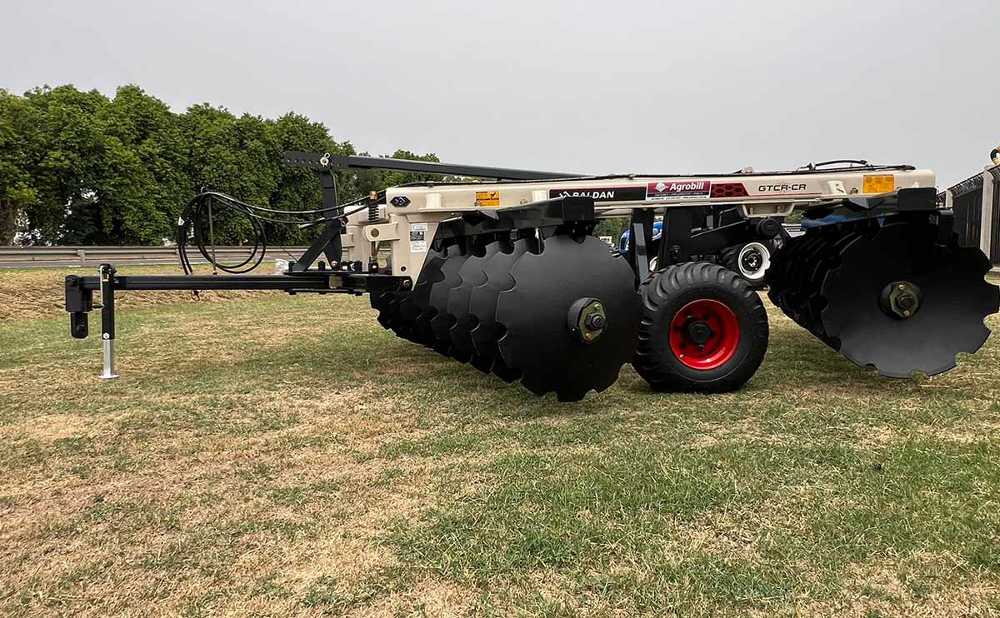{fig-align="center"}

:::

:::

## Classificação de máquinas e implementos para preparo do solo
<hr>

[__Quanto ao acoplamento à fonte de potência: Semimontados__]{.fg style="--col: #e64173"}


::: {.columns}

::: {.column}

Acontece por meio dos dois braços inferiores do sistema hidráulico de 3 pontos, sendo a parte traseira do equipamento sustentada por duas ou mais rodas.

Possui como vantagem o controle de posição do implemento, especialmente em máquinas que necessitam de controle de profundidade.

:::

::: {.column}

<br>
<br>

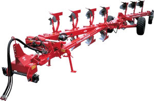{fig-align="center"}

:::

:::

## Classificação de máquinas e implementos para preparo do solo
<hr>

[__Quanto ao acoplamento à fonte de potência: Montados__]{.fg style="--col: #e64173"}


::: {.columns}

::: {.column}

A ligação do implemento com a fonte de potência é feita pelo sistema hidráulico de 3 pontos.

O implemento se comporta como uma extensão do trator.

:::

::: {.column}

<br>
<!-- <br> -->

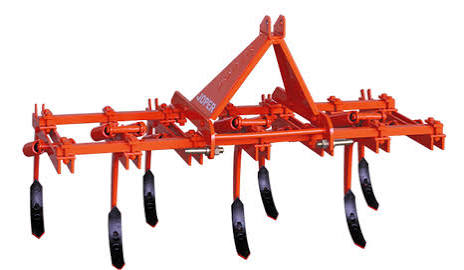{fig-align="center"}

:::

:::


# Máquinas e implementos para o preparo do solo
<hr>

## Máquinas e implementos para o preparo do solo
<hr>

[__Arados__]{.fg style="--col: #e64173"}

Embora o emprego e o uso tenham diminuído ao longo dos anos devido às técnicas conservacionistas, os arados são implementos agrícolas projetados para revolver e preparar o leito radicular, incorporar resíduos vegetais, remover camadas compactadas, entre outros.


::: {.fragment}

O princípio de funcionamento compreende o corte de uma faixa de solo, denominada "leiva", que é elevada e invertida.

:::

## Máquinas e implementos para o preparo do solo
<hr>

[__Arados__]{.fg style="--col: #e64173"}

::: {.fragment}

Podem ser subdivididos em:

::: {.incremental}

- Número de órgãos ativos;
  - Monocorpo, bicorpo, tricorpo e multicorpo;
- Quanto à movimentação;
  - Fixos e reversíveis;
- Quanto ao tipo de órgãos ativos;
  - Aivecas e discos.

:::

:::

## Máquinas e implementos para o preparo do solo
<hr>

[__Arados de aiveca__]{.fg style="--col: #e64173"}

::: {layout-ncol=3}

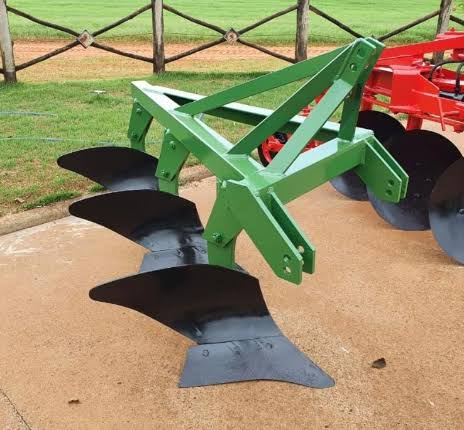{fig-align="center"}

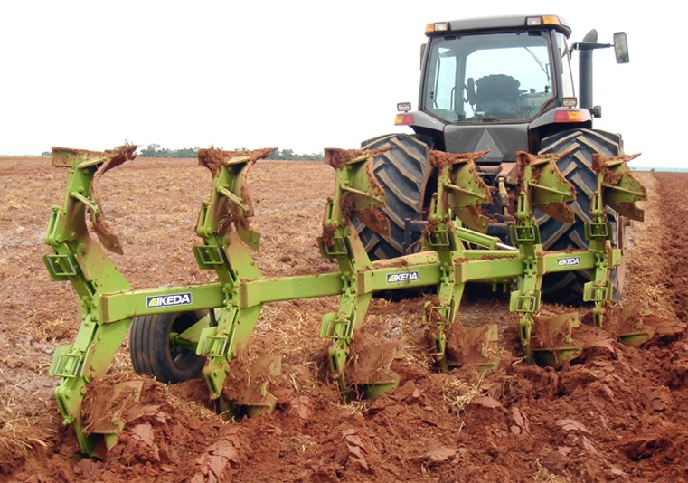{fig-align="center" width="500"}

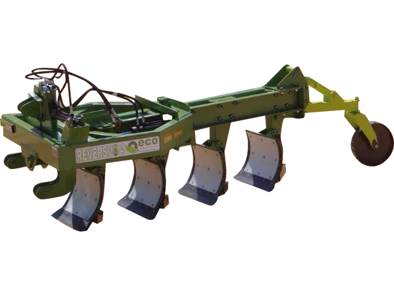{fig-align="center" }

:::

## Máquinas e implementos para o preparo do solo
<hr>

[__Arados de aiveca__]{.fg style="--col: #e64173"}

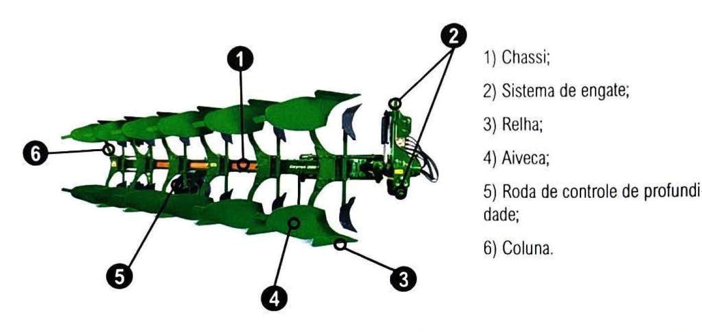{fig-align="center"}

## Máquinas e implementos para o preparo do solo
<hr>

[__Arados de aiveca__]{.fg style="--col: #e64173"}

::: {layout-ncol=2}

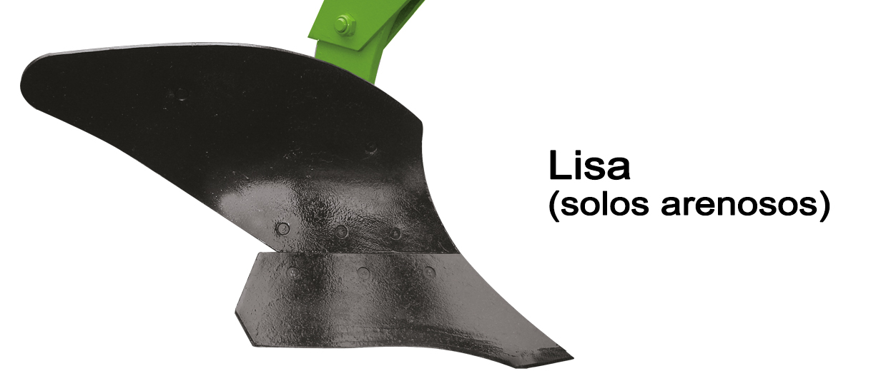{fig-align="center"}

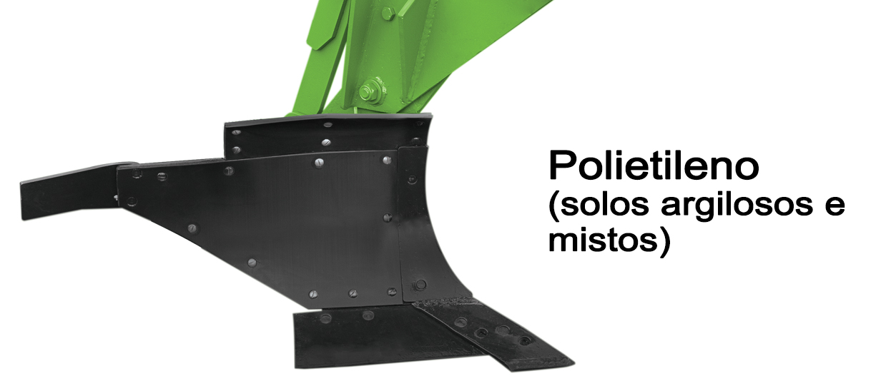{fig-align="center"}

:::

## Máquinas e implementos para o preparo do solo
<hr>

[__Arados de discos__]{.fg style="--col: #e64173"}

::: {layout-ncol=2}

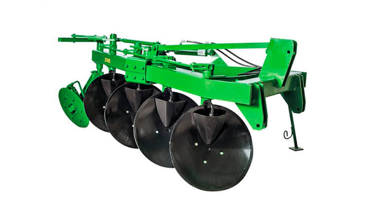{fig-align="center"}

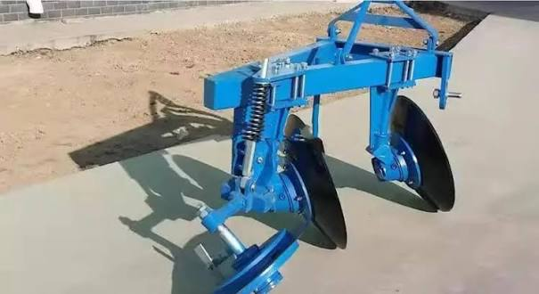{fig-align="center"}

:::

## Máquinas e implementos para o preparo do solo
<hr>

[__Arados de discos__]{.fg style="--col: #e64173"}

{fig-align="center" }

## Máquinas e implementos para o preparo do solo
<hr>

[__Arados de discos__]{.fg style="--col: #e64173"}

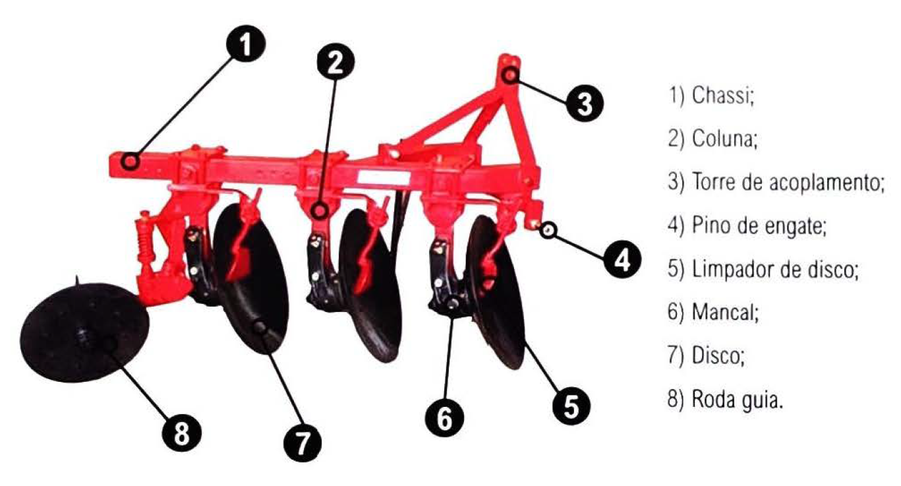{fig-align="center"}

## Máquinas e implementos para o preparo do solo
<hr>

[__Grades agrícolas__]{.fg style="--col: #e64173"}

Têm como objetivo principal o preparo secundário do solo, que envolve destorroamento e nivelamento após o preparo inicial.


::: {.fragment}

Podem ser subdivididas em:

::: {.incremental}

- Quanto ao tipo de órgão ativo;
- Quanto à ação no solo ou à disposição dos eixos;
- Quanto ao diâmetro dos discos e ao espaçamento entre discos.

:::

:::

## Máquinas e implementos para o preparo do solo
<hr>

[__Grades agrícolas: Grades de dentes__]{.fg style="--col: #e64173"}

Pouco utilizadas no Brasil, o componente principal é uma ponta de aço (dente), de alta resistência à abrasão.

Eficientes em solos com pouco resíduo vegetal.


::: {.fragment}

Podem ser subdivididas em:

::: {.columns}

::: {.column}

::: {.incremental}

- Dentes rígidos;
- Dentes flexíveis (molas);
- Oscilantes;

:::

:::

::: {.column}

::: {.incremental}

- Giratórios;
- Eixos rotativos.

:::

:::

:::


:::

## Máquinas e implementos para o preparo do solo
<hr>

[__Grades agrícolas: Grades de dentes__]{.fg style="--col: #e64173"}

::: {layout-ncol=2}

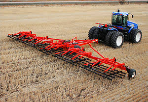{fig-align="center" width="450px"}

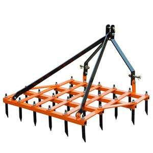{fig-align="center" width="350px"}

:::

## Máquinas e implementos para o preparo do solo
<hr>

[__Grades agrícolas: Grades de discos__]{.fg style="--col: #e64173"}

São responsáveis pela mobilização do solo por meio de calotas esféricas (discos).

::: {.fragment}

Normalmente, os discos das grades são menores e apresentam profundidade média de penetração mais superficial, em torno de 1/6 do seu diâmetro, enquanto o disco do arado apresenta profundidade média de penetração de 1/3 do seu diâmetro.

:::

## Máquinas e implementos para o preparo do solo
<hr>

[__Grades agrícolas: Grades de discos__]{.fg style="--col: #e64173"}

::: {.fragment}

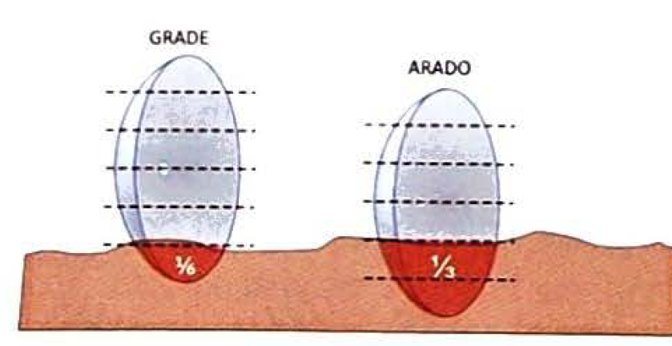{fig-align="center"}

:::


## Máquinas e implementos para o preparo do solo
<hr>

[__Grades agrícolas: Grades de discos__]{.fg style="--col: #e64173"}

São melhores em relação às de dentes, pois possuem maior capacidade de picar e incorporar resíduos vegetais, apresentando bom trabalho tanto em solos leves quanto em solos pesados.

## Máquinas e implementos para o preparo do solo
<hr>

[__Grades agrícolas: Grades de discos__]{.fg style="--col: #e64173"}

::: {layout-ncol=2}

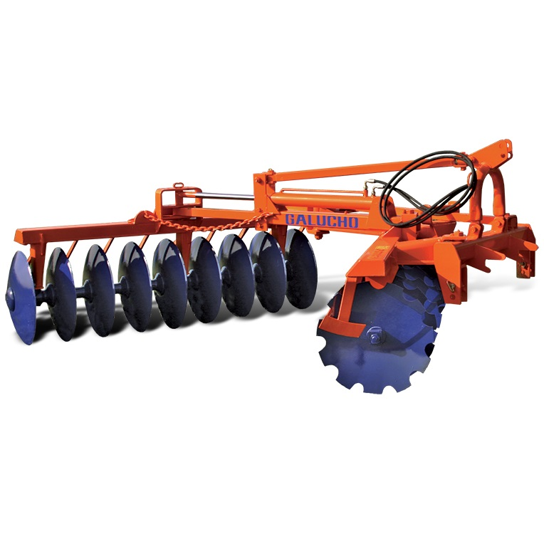{fig-align="center" width="450px"}

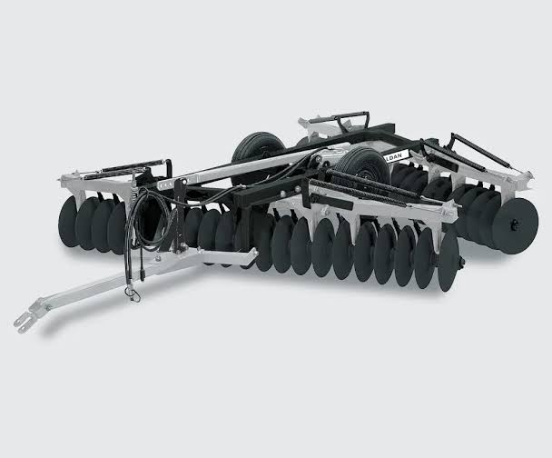{fig-align="center" width="350px"}

:::

## Máquinas e implementos para o preparo do solo
<hr>

[__Grades agrícolas: Grades de discos__]{.fg style="--col: #e64173"}

Disposição dos eixos

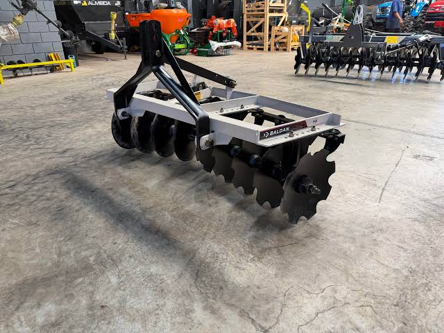{fig-align="center"}

## Máquinas e implementos para o preparo do solo
<hr>

[__Grades agrícolas: Grades de discos__]{.fg style="--col: #e64173"}

Disposição dos eixos

::: {layout-ncol=2}

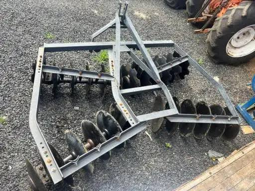{fig-align="center" width="450px"}

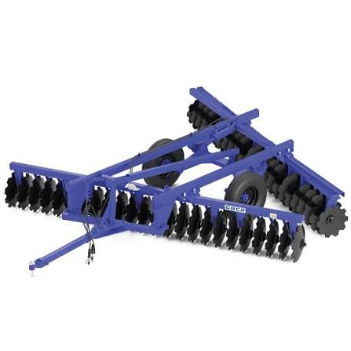{fig-align="center" width="350px"}

:::

## Máquinas e implementos para o preparo do solo
<hr>

[__Grades agrícolas: Espaçamento entre discos__]{.fg style="--col: #e64173"}

::: {tbl-cap="Classificação de grades de discos quanto à função no preparo do solo" style="font-size:24px"}

| Classe | Distância (cm) | Diâmetro (pol.) | Finalidade |
|:--|-:|-:|:---------|
| **Ultraleve** | 18 | 18 | Limpeza de entrelinhas e eliminação de plantas daninhas a pequena profundidade. |
| **Leve** | 20 | 20 | Nivelamento e destorroamento final em cereais. |
| **Leve** | 23 | 24 | Nivelamento e destorroamento final em cana-de-açúcar. |
| **Média (GAI)** | 27 | 28 | Preparo do solo para cereais e reforma de pastagens. |
| **Pesada (GAP)** | 34 | 32 | Preparo mais profundo, especialmente em cana-de-açúcar e áreas novas. |
| **Superpesada (GASP)** | 45 | 36 | Preparo profundo em condições de maior dificuldade de penetração e corte de restos vegetais. |

:::

## Máquinas e implementos para o preparo do solo
<hr>

[__Grades agrícolas: Espaçamento entre discos__]{.fg style="--col: #e64173"}

::: {tbl-cap="Uso de grades de discos segundo o espaçamento entre discos" style="font-size:24px"}

| Espaçamento (cm) | Aplicações |
|:---:|:---|
| **18** | Preparo secundário em solo arado com pouco resíduo superficial;<br>Solo extremamente duro. |
| **23** | Operações convencionais de corte de resíduos superficiais;<br>Incorporação de agroquímicos;<br>Incorporação de sementes miúdas. |
| **28** | Trabalho profundo com abundante resíduo superficial;<br>Preparo para a semeadura em solos que se desintegram com facilidade. |
| **33 ou mais** | Para grande profundidade de trabalho em condições extremas de solo e resíduos superficiais abundantes;<br>Preparo primário. |

:::

## Máquinas e implementos para o preparo do solo
<hr>

[__Grades agrícolas: Grades de discos__]{.fg style="--col: #e64173"}

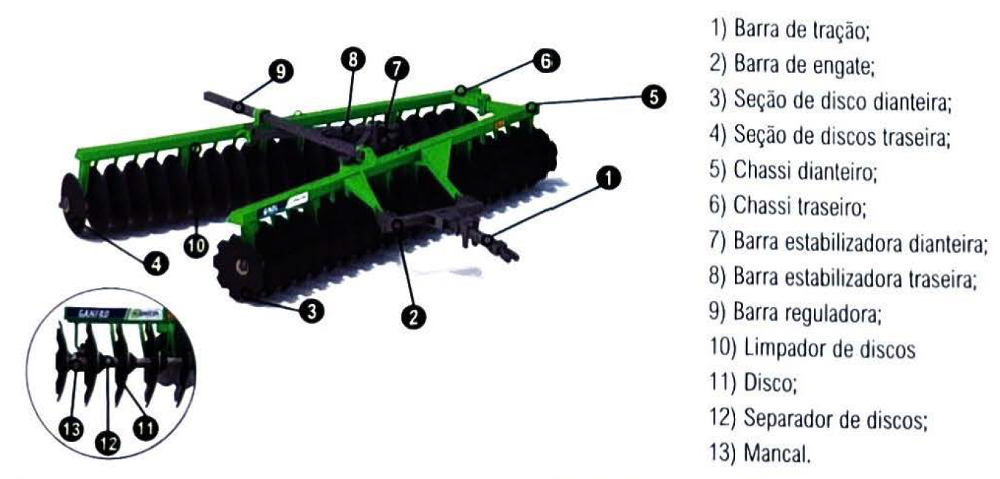{fig-align="center"}

## Máquinas e implementos para o preparo do solo
<hr>

[__Grades agrícolas: Grades de discos__]{.fg style="--col: #e64173"}

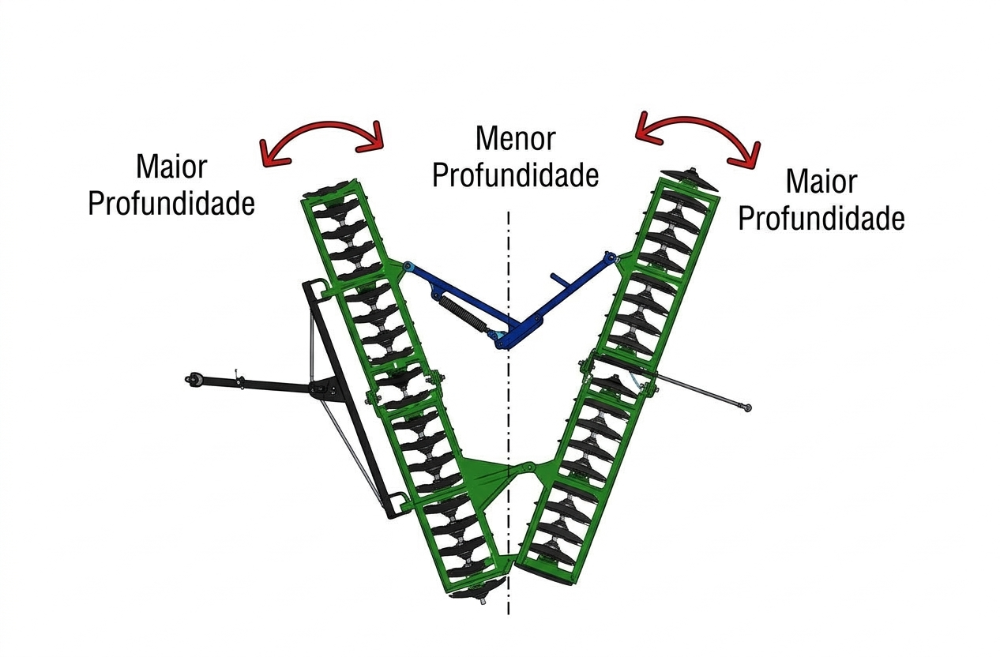{fig-align="center"}

## Máquinas e implementos para o preparo do solo
<hr>

[__Grades agrícolas: Grades de discos__]{.fg style="--col: #e64173"}

::: {tbl-cap="Resumo dos critérios utilizados para classificação de grades" style="font-size:26px"}

| **Critério** | **Classificação / Característica** |
|:---|:---|
| **Tipo de órgão ativo** | Dentes<br>Discos |
| **Fonte de potência (tração)** | Animal<br>Mecânica |
| **Acoplamento à fonte de potência** | Arrasto (BT)<br>Semimontado<br>Montado (SHTP) |
| **Quanto à ação no solo ou disposição dos eixos** | Simples ação<br>Dupla ação *Off-set*<br>Dupla ação *Tandem* |
| **Quanto à finalidade baseada no espaçamento entre discos e diâmetro de disco** | Ultraleve<br>Leve<br>Média<br>Pesada<br>Superpesada |

:::

## Máquinas e implementos para o preparo do solo
<hr>

[__Escarificadores e subsoladores__]{.fg style="--col: #e64173"}

São equipamentos que trabalham a superfície e a subsuperfície do solo, respectivamente, para promover o rompimento de camadas compactadas.


::: {.fragment}

Possuem o mesmo princípio de rompimento do solo, por propagação de trincas nas linhas de fratura naturais ou por meio dos agregados, diferentemente de arados e grades, que cortam o solo.

:::


::: {.fragment}

[__Escarificação:__]{.fg style="--col: #e64173"} é uma operação de preparo do solo.

:::

::: {.fragment}

[__Subsolagem:__]{.fg style="--col: #e64173"} é uma prática conservacionista que visa à remoção de camadas compactadas em subsuperfície.

:::

## Máquinas e implementos para o preparo do solo
<hr>

[__Escarificadores e subsoladores__]{.fg style="--col: #e64173"}

::: {layout-ncol=2}

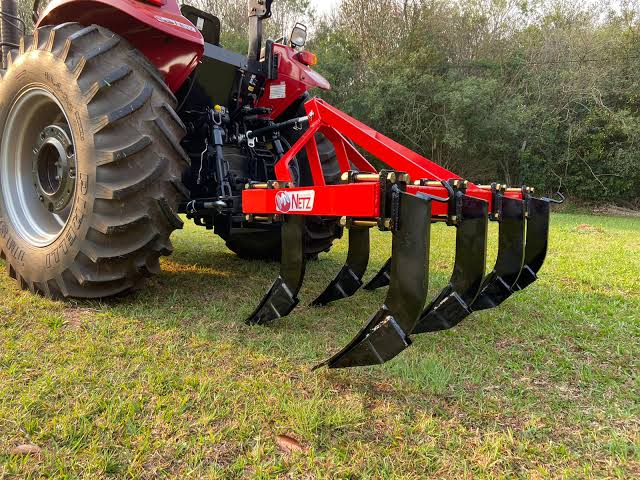{fig-align="center" width="450px"}

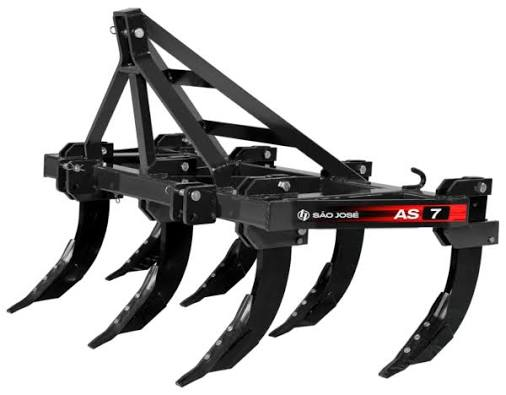{fig-align="center" width="350px"}

:::

## Máquinas e implementos para o preparo do solo
<hr>

[__Escarificadores e subsoladores__]{.fg style="--col: #e64173"}

::: {layout-ncol=2}

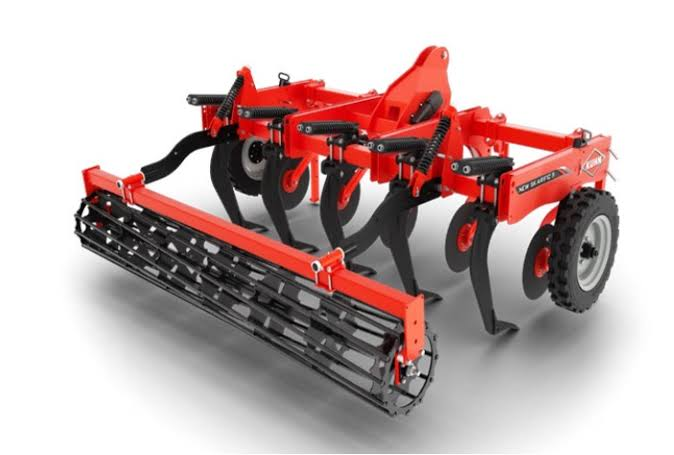{fig-align="center" width="450px"}

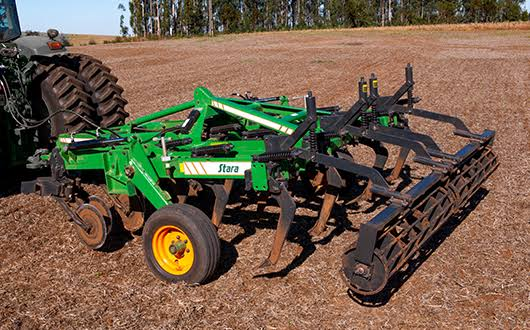{fig-align="center" width="350px"}

:::

## Máquinas e implementos para o preparo do solo
<hr>

[__Escarificadores e subsoladores__]{.fg style="--col: #e64173"}

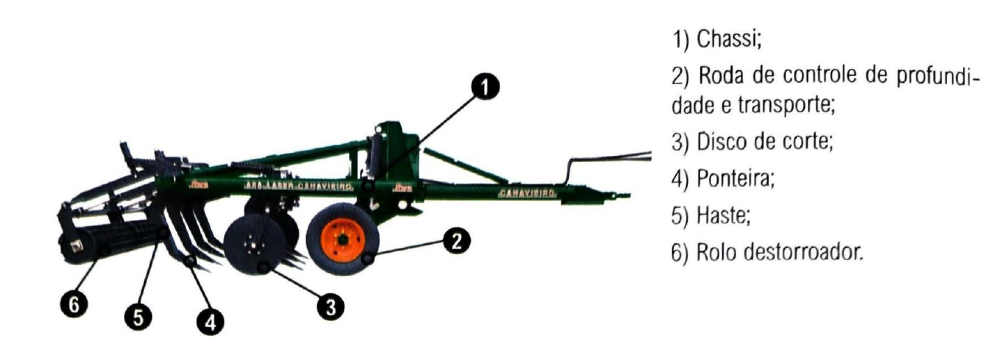{fig-align="center"}

## Máquinas e implementos para o preparo do solo
<hr>

[__Escarificadores e subsoladores__]{.fg style="--col: #e64173"}

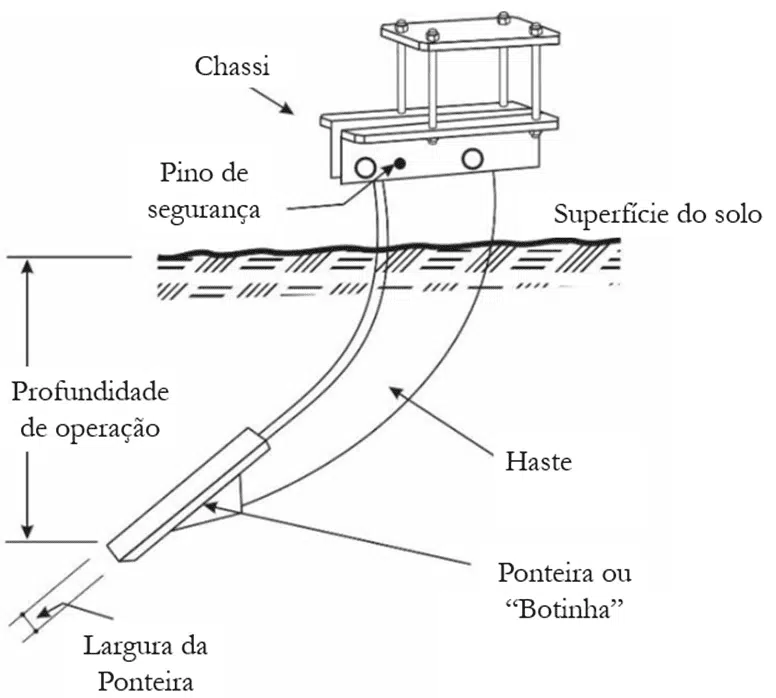{fig-align="center"}

## Máquinas e implementos para o preparo do solo
<hr>

[__Escarificadores e subsoladores__]{.fg style="--col: #e64173"}

Tipos de hastes

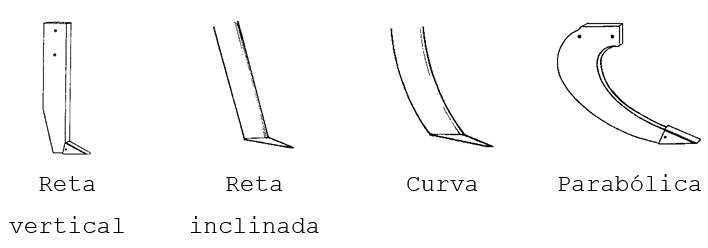{fig-align="center"}

## Máquinas e implementos para o preparo do solo
<hr>

[__Escarificadores e subsoladores__]{.fg style="--col: #e64173"}

Molas helicoidais

Sistema de segurança com mola helicoidal que permite que a haste desarme, contorne o obstáculo e rearme sozinha.


::: {.fragment}

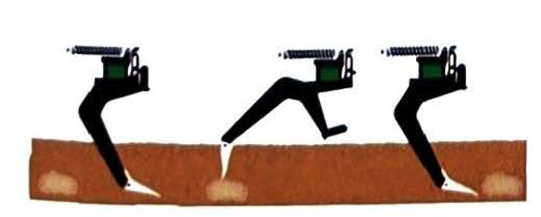{fig-align="center"}

:::

## Máquinas e implementos para o preparo do solo
<hr>

[__Escarificadores e subsoladores__]{.fg style="--col: #e64173"}

Molas helicoidais

::: {layout-ncol=2}

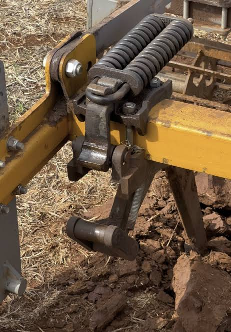{fig-align="center" width="300px"}

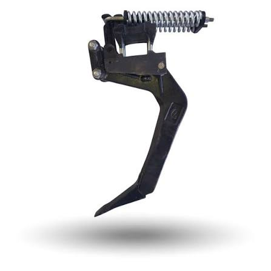{fig-align="center" width="350px"}

:::

## Máquinas e implementos para o preparo do solo
<hr>

[__Escarificadores e subsoladores__]{.fg style="--col: #e64173"}

::: {tbl-cap="Resumo dos critérios utilizados para classificação de escarificadores e subsoladores"}

| **Critério** | **Característica** |
|:---|:---|
| **Tipo de órgão ativo (ponteiras)** | Sem asas<br>Com asas |
| **Fonte de potência (tração)** | Animal<br>Mecânica |
| **Acoplamento à fonte de potência** | Arrasto (BT)<br>Semimontado<br>Montado (SHTP) |
| **Quanto à profundidade de trabalho** | Escarificação leve (5 a 15 cm)<br>Escarificação pesada (15 a 30 cm)<br>Subsolagem (30 cm ou mais) |

:::

## Máquinas e implementos para o preparo do solo
<hr>

[__Enxadas rotativas__]{.fg style="--col: #e64173"}

Promovem a mobilização do solo, na profundidade de até 0,3 m, por meio de múltiplas lâminas posicionadas em um rotor transversal ao sentido de deslocamento.


::: {.fragment}

O rápido giro do rotor permite que uma camada de solo seja cortada e lançada em direção a uma chapa na parte traseira da máquina (placa de impacto).

:::

## Máquinas e implementos para o preparo do solo
<hr>

[__Enxadas rotativas__]{.fg style="--col: #e64173"}

::: {layout-ncol=2}

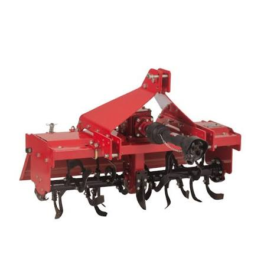{fig-align="center" width="400px"}

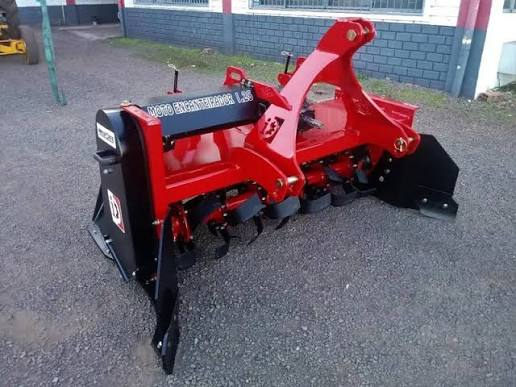{fig-align="center" width="350px"}

:::

## Máquinas e implementos para o preparo do solo
<hr>

[__Enxadas rotativas__]{.fg style="--col: #e64173"}

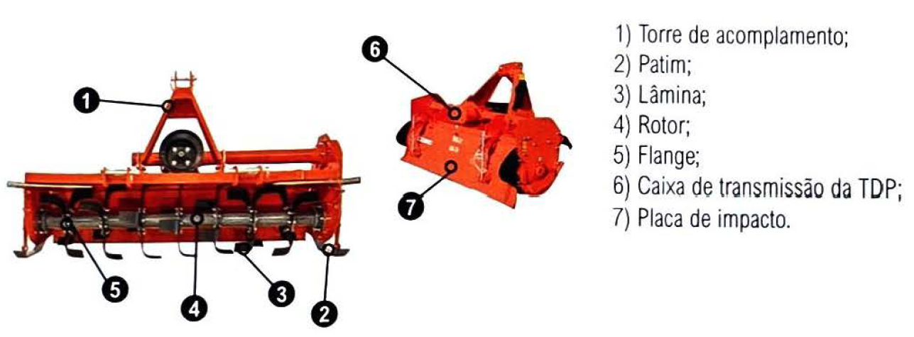{fig-align="center"}


## Máquinas e implementos para o preparo do solo
<hr>


::: {tbl-cap="Equipamentos recomendados para cada operação básica de preparo do solo" style="font-size:22px"}

| **Operação** | **Objetivo** | **Resistência ao cisalhamento**<br>**Solo** | **Resistência ao cisalhamento**<br>**Torrão** | **Consistência do solo** | **Direção da força resultante** | **Equipamento** |
|:---|:---|:---:|:---:|:---|:---:|:---|
| **Rompimento** | Aumentar a porosidade e romper camadas compactadas | Baixa | Alta ou baixa | Duro ou friável | Para cima | **Subsolador** |
| **Compactação** | Aumento de massa da unidade de solo | Alta | Baixa | Friável | Para baixo ou para os lados | **Grade de dentes vibratórios ou não** |
| **Desintegração** | Reduzir o tamanho do torrão | Alta | Baixa | Friável | Para baixo | **Rolo e enxada rotativa** |
| **Corte** | Reduzir o tamanho do torrão | Baixa | Alta | Plástico | Para baixo | **Grade** |
| **Inversão** | Enterrar materiais vegetais e inverter o solo | Alta | Alta ou baixa | Friável ou plástico | — | **Arado** |
| **Mistura** | Misturar aditivos ao solo | Baixa | Alta ou baixa | Friável | — | **Enxada rotativa ou grade de discos** |

:::

# Fim!
<hr>
