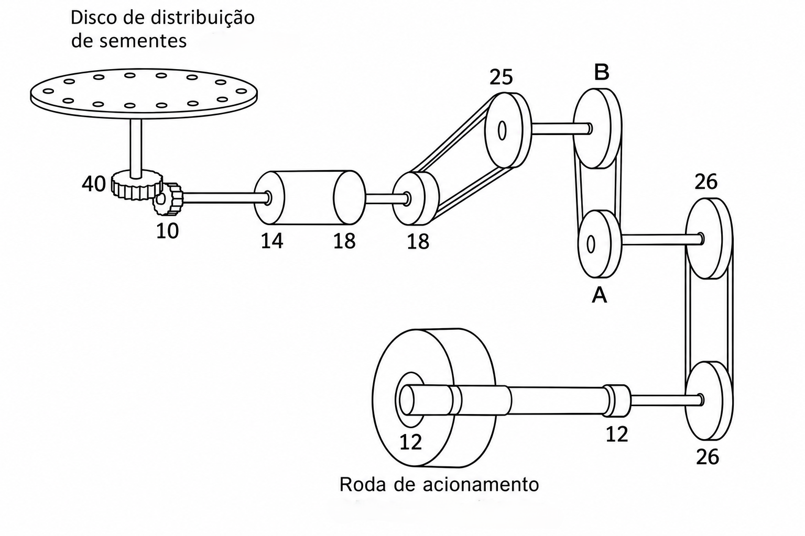

## Exercícios
<hr>

```{r}
library(countdown)

countdown(
  minutes = 5,
  seconds = 0,
  right = 0,
  top = 0,
  padding = "5px",
  margin = "0%",
)
```

1 - Cultivo de trigo: quero uma população de **3500000 plantas ha^-1^**, com espaçamento entre linhas de **17 cm**, PMS de **44 g** e germinação de **93%**.
Qual a quantidade de sementes (kg) que devo largar por metro? Qual a quantidade de sementes (kg) por hectare?


::: {.fragment}

Resultado:

::: {.columns style="font-size:22px"}

::: {.column}

::: {.fragment}


$$
Q_{metro}= (\frac{100}{0,17})*100 = 58823.53~m~(lineares)
$$

:::

::: {.fragment}

$$
Pop = \frac{ 3500000}{0.93}= 3763441~plantas~ha^{-1}
$$

:::

:::

::: {.column}


::: {.fragment}

$$
NS = \frac{3763441}{58823.53} = 63.9785~plantas~m^{-1}
$$

:::


::: {.fragment}

$$
NS_{peso}= \frac{63.9785~plantas~m^{-1} * 44~g}{1000} = 2.82~g~m^{-1}
$$

:::


::: {.fragment}

$$
Peso_{total}= \frac{3763441 * 44~g}{1000} = \frac{ 165591.4}{1000} = 165.59~kg~ha^{-1}
$$

:::


:::

:::

:::


## Exercícios
<hr>

```{r}
library(countdown)

countdown(
  minutes = 5,
  seconds = 0,
  right = 0,
  top = 0,
  padding = "5px",
  margin = "0%",
)
```

2 - Cultivo de milho: quero uma população de **80000 plantas ha^-1^**, com espaçamento entre linhas de **45 cm** e germinação de **95%**.
Qual a quantidade de sementes que devo largar por metro? Qual a quantidade de sementes por hectare?


::: {.fragment}

Resultado:

::: {.columns style="font-size:22px"}

::: {.column}

::: {.fragment}


$$
Q_{metro}= (\frac{100}{0.45})*100 = 22222.22~m~(lineares)
$$

:::

::: {.fragment}

$$
Pop = \frac{80000}{0.95}= 84210.53~plantas~ha^{-1}
$$

:::

:::

::: {.column}


::: {.fragment}

$$
NS = \frac{84210.53}{22222.22} = 3.789~plantas~m^{-1}
$$

:::

:::

:::

:::

## Exercícios
<hr>

```{r}
library(countdown)

countdown(
  minutes = 5,
  seconds = 0,
  right = 0,
  top = 0,
  padding = "5px",
  margin = "0%",
)
```

3 - Cultivo de soja: quero uma população de **300000 plantas ha^-1^**, com espaçamento entre linhas de **45 cm**, germinação de **98%** e pureza de **99%**.
Qual a quantidade de sementes que devo largar por metro? Qual a quantidade de sementes por hectare?


::: {.fragment}

Resultado:

::: {.columns style="font-size:22px"}

::: {.column}

::: {.fragment}


$$
Q_{metro}= (\frac{100}{0.45})*100 = 22222.22~m~(lineares)
$$

:::

::: {.fragment}

$$
Pop_{G} = \frac{300000}{0.98}= 306122.4~plantas~ha^{-1}
$$

:::


::: {.fragment}

$$
Pop_{P} = \frac{306122.4}{0.99}= 309214.5~plantas~ha^{-1}
$$
:::


:::

::: {.column}


::: {.fragment}

$$
NS = \frac{309214.5}{22222.22} = 13.914~plantas~m^{-1}
$$

:::

:::

:::

:::


## Exercícios
<hr>

```{r}
library(countdown)

countdown(
  minutes = 5,
  seconds = 0,
  right = 0,
  top = 0,
  padding = "5px",
  margin = "0%",
)
```

4 - Cultivo de soja: 

::: {style="font-size:22px"}
Temos um conjunto (trator-semeadora) com engrenagem motora de 14 dentes e engrenagem movida de 19 dentes. A deposição de sementes é de 15 sementes m^-1^, com disco de 92 furos. A semente utilizada possui vigor de 88%.

::: {.fragment}

A recomendação é que tenhamos 13,5 plantas viáveis a cada metro, com espaçamento de 45 cm, usando um disco de 62 furos.

:::

:::

::: {.fragment style="font-size:22px"}

Resultado:


::: {.fragment}


$$
S_{metro}= (\frac{13.5}{0.88}) = 15.34~sementes~m^{-1}
$$

:::

::: {.fragment}

Discos:

$$
\frac{92~furos}{62~furos} = \frac{15~sementes}{x} \quad\Rightarrow\quad x = \frac{62 \cdot 15.34}{92} = 10.1087~sementes~m^{-1}
$$

:::

:::


## Exercícios
<hr>

```{r}
library(countdown)

countdown(
  minutes = 5,
  seconds = 0,
  right = 0,
  top = 0,
  padding = "5px",
  margin = "0%",
)
```

4 - Cultivo de soja: 

::: {style="font-size:22px"}
Temos um conjunto (trator-semeadora) com engrenagem motora de 14 dentes e engrenagem movida de 19 dentes. A deposição de sementes é de 15 sementes m^-1^, com disco de 92 furos. A semente utilizada possui vigor de 88%.

A recomendação é que tenhamos 13,5 plantas viáveis a cada metro, com espaçamento de 45 cm, usando um disco de 62 furos.

:::

::: {.fragment style="font-size:22px"}

Resultado:

::: {.fragment}

Relação de engrenagens:

$14/19 = 0,7368$

$$
\frac{0.7368}{x} = \frac{10.1087~sementes}{15.34~sementes} \quad\Rightarrow\quad x = \frac{0.7368 \cdot 15.34}{10.1087} = 1.118
$$
:::

::: {.fragment}

$$
Pop_{alvo} = 13.5 * 22222.22 = 300000~plantas~ha^{-1}
$$

:::

:::

## Relações de engrenagens

```{r}
#| echo: false
#| fig-width: 11
#| fig-height: 8
#| out-width: 100%
#| fig-align: center

library(ggplot2)
library(dplyr)

dentes <- 6:25

dados <- expand.grid(motora = dentes, movida = dentes) |>
  mutate(
    relacao = movida / motora
    # inteira = relacao == round(relacao) & relacao != 1
  )

ggplot(dados, aes(factor(movida), factor(motora), fill = log2(relacao))) +
  geom_tile(color = "white", linewidth = 0.5) +
  # contorno nos pares com relação inteira
  # geom_tile(
  #   data = filter(dados, inteira),
  #   fill = NA,
  #   color = "grey10",
  #   linewidth = 0.9
  # ) +
  geom_text(
    aes(label = sprintf("%.2f", relacao)),
    size = 2.8,
    color = "grey15"
  ) +
  scale_fill_gradient2(
    low = "#2c7bb6",
    mid = "white",
    high = "#d7191c",
    midpoint = 0,
    limits = c(-2.1, 2.1),
    breaks = c(-2, -1, 0, 1, 2),
    labels = c("0,25×", "0,5×", "1×", "2×", "4×"),
    name = "Relação\n(motora÷movida  )"
  ) +
  scale_x_discrete(position = "top") +
  scale_y_discrete(limits = rev) +
  coord_fixed() +
  labs(
    # title = "Relação de engrenagens de 6 a 25 dentes",
    # subtitle = "Contorno preto: relações inteiras (2:1, 3:1, 4:1)",
    y = "Dentes da engrenagem movida",
    x = "Dentes da engrenagem motora"
  ) +
  theme_minimal(base_size = 16) +
  theme(
    panel.grid = element_blank(),
    plot.title = element_text(face = "bold", size = 22),
    plot.subtitle = element_text(color = "grey40"),
    axis.title = element_text(color = "grey30"),
    legend.position = "right",
    plot.margin = margin(10, 10, 10, 10)
  )
```


## Exercícios
<hr>

```{r}
library(countdown)

countdown(
  minutes = 5,
  seconds = 0,
  right = 0,
  top = 0,
  padding = "5px",
  margin = "0%",
)
```


4 - Cultivo de soja: 


::: {.columns style="font-size:22px"}

::: {.column width="70%"}

Agora, o conjunto já está regulado para distribuir 15,34 sementes m^-1^, considerando todas as configurações de disco, espaçamento e vigor. No entanto, queremos saber se a operação está sendo bem conduzida. Para isso, 5 amostras foram coletadas durante a operação para verificar se a quantidade de sementes depositada corresponde à regulada.

:::

::: {.column  width="30%"}

| Distância | Sementes | Distância entre sementes 
|:----------:|:----------:|:----------:|
| 100 cm         | 13     |      7,69 cm      |
| 100 cm         | 14,2   |      7,04 cm  |
| 100 cm         | 15,2   |      6,58 cm    |
| 100 cm         | 15     |     6,67 cm     |
| 100 cm         | 15,3   |      6,53 cm    |


:::

:::


::: {.columns style="font-size:22px"}

::: {.column}

::: {.fragment }

Sementes por metro:

$$
\bar{x} = \frac{13 + 14{,}2 + 15{,}2 + 15 + 15{,}3}{5}
= 14{,}54
$$

$$
s = \sqrt{\frac{\sum_{i=1}^{n}(x_i-\bar{x})^2}{n-1}}
= 0{,}96
$$

$$
CV = \frac{s}{\bar{x}} \times 100
= \frac{0{,}9633}{14{,}54} \times 100
= 6{,}63\%
$$


:::


:::

::: {.column}


::: {.fragment style="font-size:22px"}

E a distribuição dessas sementes nos 100 cm?


:::

:::

:::


## Exercícios
<hr>

```{r}
library(countdown)

countdown(
  minutes = 5,
  seconds = 0,
  right = 0,
  top = 0,
  padding = "5px",
  margin = "0%",
)
```


4 - Cultivo de soja: 


::: {.columns style="font-size:22px"}

::: {.column width="70%"}

Consideramos que a quantidade de sementes depositada a cada metro está dentro do aceitável em nosso exemplo. No entanto, agora queremos observar se a distribuição entre as sementes está boa. Para isso, mais 15 medidas de distância entre sementes foram coletadas. O ideal seria observar uma distância de 6,52 cm entre cada semente, mas observamos as seguintes medidas:

:::

::: {.column  width="30%"}

- Amostra 1: 6,37; 6,25; 6,55; 6,50; 6,59.
- Amostra 2: 6,40; 6,41; 6,43; 6,40; 6,43.
- Amostra 3: 6,52; 6,50; 6,50; 6,51; 6,54.

:::

:::


::: {.fragment}

Qual é a média, o desvio-padrão, o CV da amostra ou de cada amostra? Além da precisão e da acurácia da operação.

:::

# Teste
<hr>

## Teste 1
<hr>


```{r}
library(countdown)

countdown(
  minutes = 12,
  seconds = 0,
  right = 0,
  top = 0,
  padding = "5px",
  margin = "0%",
)
```


::: { .fragment style="font-size:22px"}

5 - Em busca de tempo para continuar a leitura do livro [__*A vida secreta das árvores*__]{.fg style="--col: #e64173"}, um agrônomo quer regular uma semeadora para a cultura da soja e determinar quanto tempo levará para fazer a operação de semeadura. O agrônomo/pequeno produtor possui 15 hectares, dos quais 12,5 serão cultivados com soja.

::: {.fragment}

::: {.columns}

::: {.column  width="50%"}

- A semeadora do agrônomo tem largura de trabalho de 4,5 m, e ele sempre faz a semeadura a uma velocidade de 5,5 km h^-1^. No ano passado, ele fez algumas anotações sobre o tempo gasto na operação:

::: {.fragment}

  - Tempo efetivo: ~303 minutos;
  - Manobras: ~70 minutos;
  - Abastecimento: ~60 minutos.

:::


:::

::: {.column  width="50%"}


::: {.fragment}

- Neste ano, a ideia é ter 250 mil plantas por hectare. Para isso, ele conta com uma semeadora de 10 linhas, que tem boa distribuição, mas, devido à idade do implemento, recomenda-se adicionar 10% de sementes como margem de segurança. A semente disponível na cooperativa possui PMS de 200 g e germinação de 97%, mas apresenta 2% de impurezas devido a problemas na embalagem.

:::

:::

:::

:::


::: {.fragment}


[__Quantas sementes por metro o agrônomo deve observar para ter o estande de plantas desejado? Além disso, qual é a quantidade de sementes necessária para toda a área?__]{.fg style="--col: #e64173"}

[__Também, quais são as capacidades de campo teórica e efetiva, a eficiência de campo e a capacidade de manipulação? Em quanto tempo o agrônomo poderá voltar a ler seu livro?__]{.fg style="--col: #e64173"}


:::


:::

## Teste 2
<hr>


```{r}
library(countdown)

countdown(
  minutes = 12,
  seconds = 0,
  right = 0,
  top = 0,
  padding = "5px",
  margin = "0%",
)
```


::: { .fragment style="font-size:22px"}

6 - Um agricultor deseja cultivar trigo em uma área de 42 ha. Sabe-se que a densidade de semeadura recomendada é de 125 kg ha^-1^ e de adubo 400 kg ha^-1^. Para realizar o trabalho, o agricultor possui um conjunto semeadora/adubadora com as seguintes características: 13 linhas, perímetro da roda motriz que transmite os movimentos 2,43 m, distância entre linhas de 0,17 m. Considere que a semente apresenta 95% de germinação 98% de sobrevivência e 90% de pureza. Pergunta-se:

::: {.incremental}


- [__Quais serão as quantidades (kg) de adubo e de sementes que deverão cair, por linha, se girarmos a roda motriz da semeadora 15 vezes? (Considere 5% de patinagem).__]{.fg style="--col: #e64173"}

- [__Se o agricultor coletar o adubo e as sementes de todas as linhas, quais serão as quantidades totais de adubo e de sementes que deverão cair? (Considerando os mesmos 15 giros da roda).__]{.fg style="--col: #e64173"}

- [__Quantos kg de sementes e de adubo este agricultor necessitará comprar para adubar e semear toda a sua propriedade?__]{.fg style="--col: #e64173"}

- [__A eficiência da operação é de 85 %, com isso qual valor podemos estimar para a capacidade de campo efetiva que ele pode ter?__]{.fg style="--col: #e64173"}

- [__Considerando que a capacidade de manipulação dessa operação é de 234,8 kg h^-1^ de sementes, qual a velocidade de cultivo?__]{.fg style="--col: #e64173"}

:::


:::

## Teste 3
<hr>

```{r}
library(countdown)

countdown(
  minutes = 12,
  seconds = 0,
  right = 0,
  top = 0,
  padding = "5px",
  margin = "0%",
)
```


::: { .fragment style="font-size:22px"}

7 - Considere a seguinte situação: Cultivo de milho, com população final de 67.000 plantas ha^-1^; espaçamento 0,8 m; germinação 99%; sobrevivência 95%.

Considere também, que, na regulagem da máquina percorreu-se 50m (portanto nessa regulagem a semeadora não está suspensa, ou seja, está sendo regulada no solo onde será realizada a semeadura). Nessa distância foram coletadas em média 213 sementes em cada linha da semeadora.

::: {.incremental}


- [__Qual é o número desejado de sementes por metro linear?__]{.fg style="--col: #e64173"}

- [__Qual é o número coletado de sementes por metro linear?__]{.fg style="--col: #e64173"}

- [__Considere que a relação existente na coleta das sementes era 0,82. Qual a relação necessária para que seja atingido o número desejado de sementes? Quais as engrenagens poderiam ser utilizadas para que se atinja essa relação?__]{.fg style="--col: #e64173"}

- [__Qual a acurácia da operação?__]{.fg style="--col: #e64173"}

:::

:::


## Teste 4
<hr>

```{r}
library(countdown)

countdown(
  minutes = 12,
  seconds = 0,
  right = 0,
  top = 0,
  padding = "5px",
  margin = "0%",
)
```


::: { .fragment style="font-size:22px"}

8 - Considere a imagem abaixo e os dados:


::: {.columns}

::: {.column}


- Roda de acionamento com 0,48 metros de diâmetro;
- Disco de distribuição com 92 furos.


:::

::: {.column}


{fig-align="center" width="650px"}

:::

:::

::: {.incremental}

[__Qual é relação necessária para a distribuição de 10 sementes por metro linear? Qual o número de dentes das engrenagens A e B?__]{.fg style="--col: #e64173"}


:::

:::

::: {.notes}

perímetro: diâmetro * pi

Dicas 1: A primeira pergunta que deve ser respondida é: Qual o perímetro da roda? A segunda é: A cada volta da roda, quantas sementes devem cair? A terceira é: A cada volta da roda, x (resposta da pergunta anterior) sementes devem cair, e para isso, quantas voltas o disco deve dar?


Dica 2: Anotem todas as relações de redução ou aumento, que ocorrem no esquema para facilitar o raciocínio


:::

## Teste 5
<hr>

```{r}
library(countdown)

countdown(
  minutes = 10,
  seconds = 0,
  right = 0,
  top = 0,
  padding = "5px",
  margin = "0%",
)
```

::: { .fragment style="font-size:22px"}

9 - Um produtor vai semear soja em uma área de 30 ha, com espaçamento entre linhas de 0,5 m. A população final desejada é de 280 mil plantas ha^-1^. A semente apresenta germinação de 90%, sobrevivência (emergência a campo) de 92%, pureza de 98% e PMS de 180 g.

::: {.incremental}

- [__Quantas sementes por metro linear devem ser depositadas?__]{.fg style="--col: #e64173"}

- [__Qual é a dose de semeadura em kg ha^-1^?__]{.fg style="--col: #e64173"}

- [__Qual é a quantidade total de sementes (kg) necessária para os 30 ha?__]{.fg style="--col: #e64173"}

:::

:::

::: {.notes}

Gabarito: ~16,9 sementes/m; ~62,1 kg/ha; ~1.863 kg (~1,86 t).

Dica: sementes/ha = população / (G * S). Metros lineares por ha = 10000 / espaçamento. Dose (kg/ha) = (sementes/ha * PMS/1000) / (pureza * 1000).

:::


## Teste 6
<hr>

```{r}
library(countdown)

countdown(
  minutes = 10,
  seconds = 0,
  right = 0,
  top = 0,
  padding = "5px",
  margin = "0%",
)
```

::: { .fragment style="font-size:22px"}

10 - Uma propriedade possui 80 ha para semeadura de milho. A semeadora tem 6 linhas espaçadas em 0,9 m e trabalha a 6 km h^-1^, com eficiência de campo de 75%. O consumo médio do trator durante a operação é de 6 L h^-1^.

::: {.incremental}

- [__Quais são as capacidades de campo teórica e efetiva (ha h^-1^)?__]{.fg style="--col: #e64173"}

- [__Quantas horas serão necessárias para semear toda a área? Se a jornada é de 8 h por dia, quantos dias de trabalho?__]{.fg style="--col: #e64173"}

- [__Qual será o consumo total de combustível na operação?__]{.fg style="--col: #e64173"}

:::

:::

::: {.notes}

Gabarito: CCT = 3,24 ha/h; CCE = 2,43 ha/h; ~32,9 h (~4,1 dias); ~197 L.

:::


## Teste 7
<hr>

```{r}
library(countdown)

countdown(
  minutes = 12,
  seconds = 0,
  right = 0,
  top = 0,
  padding = "5px",
  margin = "0%",
)
```

::: { .fragment style="font-size:22px"}

11 - A roda motriz de uma semeadora possui 0,60 m de diâmetro. Para determinar a patinagem, o operador marcou a roda e a fez girar 20 voltas com a máquina em operação no solo, medindo uma distância percorrida de 34,5 m. O sistema de transmissão é regulado para que o disco dosador deposite 24 sementes por volta da roda motriz.

::: {.incremental}

- [__Qual é o perímetro da roda e a distância teórica percorrida em 20 voltas?__]{.fg style="--col: #e64173"}

- [__Qual é a patinagem (%)?__]{.fg style="--col: #e64173"}

- [__Qual é o número de sementes por metro linear teórico (sem patinagem) e o real (com patinagem)?__]{.fg style="--col: #e64173"}

:::

:::

::: {.notes}

Gabarito: perímetro = 1,885 m; teórica = 37,7 m; patinagem ~8,5%; teórico ~12,7 sementes/m; real ~13,9 sementes/m.

Dica: patinagem (%) = (distância teórica - distância real) / distância teórica * 100.

:::


## Teste 8
<hr>

```{r}
library(countdown)

countdown(
  minutes = 12,
  seconds = 0,
  right = 0,
  top = 0,
  padding = "5px",
  margin = "0%",
)
```

::: { .fragment style="font-size:22px"}

12 - Na regulagem de uma semeadora de soja (espaçamento de 0,45 m), deseja-se uma população final de 300 mil plantas ha^-1^, com germinação de 85% e sobrevivência de 90%. A máquina percorreu 30 m e foram coletadas as sementes de 4 linhas, obtendo-se 520, 540, 515 e 525 sementes, respectivamente.

::: {.incremental}

- [__Qual é o número desejado de sementes por metro linear?__]{.fg style="--col: #e64173"}

- [__Qual é o número médio coletado de sementes por metro linear?__]{.fg style="--col: #e64173"}

- [__Qual é a acurácia da operação (%)? Precisa de novo ajuste?__]{.fg style="--col: #e64173"}

- [__Qual é o coeficiente de variação (%) entre as linhas?__]{.fg style="--col: #e64173"}

:::

:::

::: {.notes}

Gabarito: desejado ~17,65 sementes/m; coletado = 525/30 = 17,5 sementes/m; acurácia ~99,2% (erro de ~-0,85%); desvio-padrão amostral ~10,8 sementes; CV ~2,1%.

:::


## Teste 9
<hr>

```{r}
library(countdown)

countdown(
  minutes = 10,
  seconds = 0,
  right = 0,
  top = 0,
  padding = "5px",
  margin = "0%",
)
```

::: { .fragment style="font-size:22px"}

13 - Em uma área de 50 ha de milho, com espaçamento de 0,8 m, será aplicado no sulco de semeadura o formulado 08-28-16 (N-P~2~O~5~-K~2~O) na dose de 350 kg ha^-1^.

::: {.incremental}

- [__Quantos gramas de adubo devem cair por metro linear?__]{.fg style="--col: #e64173"}

- [__Quantos kg de adubo devem ser coletados por linha em um percurso de 100 m?__]{.fg style="--col: #e64173"}

- [__Quais são as doses de N, P~2~O~5~ e K~2~O (kg ha^-1^)?__]{.fg style="--col: #e64173"}

- [__Quantos sacos de 50 kg serão necessários para toda a área?__]{.fg style="--col: #e64173"}

:::

:::

::: {.notes}

Gabarito: 28 g/m; 2,8 kg por linha em 100 m; N = 28, P~2~O~5~ = 98, K~2~O = 56 kg/ha; 17.500 kg = 350 sacos.

:::


## Teste 10
<hr>

```{r}
library(countdown)

countdown(
  minutes = 12,
  seconds = 0,
  right = 0,
  top = 0,
  padding = "5px",
  margin = "0%",
)
```

::: { .fragment style="font-size:22px"}

14 - Um agricultor vai semear trigo em 40 ha com uma semeadora de largura de trabalho de 3,0 m, a 6 km h^-1^. Pelas anotações da safra anterior, além do tempo efetivo de semeadura, a operação teve 3 h de manobras, 2 h de abastecimento e 1 h de paradas diversas (regulagens e pequenos reparos).

::: {.incremental}

- [__Qual é a capacidade de campo teórica?__]{.fg style="--col: #e64173"}

- [__Qual é o tempo efetivo necessário para semear os 40 ha?__]{.fg style="--col: #e64173"}

- [__Qual é o tempo total da operação, a capacidade de campo efetiva e a eficiência de campo?__]{.fg style="--col: #e64173"}

- [__Se a eficiência fosse reduzida em 10 pontos percentuais por falta de planejamento, quanto tempo a mais seria gasto?__]{.fg style="--col: #e64173"}

:::

:::

::: {.notes}

Gabarito: CCT = 1,8 ha/h; tempo efetivo ~22,2 h; tempo total ~28,2 h; CCE ~1,42 ha/h; eficiência ~78,7%.

Para a última pergunta: nova eficiência ~68,7%, CCE ~1,24 ha/h, tempo total ~32,3 h (~4,1 h a mais).

:::


## Teste 11
<hr>

```{r}
library(countdown)

countdown(
  minutes = 12,
  seconds = 0,
  right = 0,
  top = 0,
  padding = "5px",
  margin = "0%",
)
```

::: { .fragment style="font-size:22px"}

15 - Um produtor semeia feijão com dose de 60 kg ha^-1^ e espaçamento de 0,5 m. A semente tem PMS de 250 g, pureza de 98%, germinação de 90% e sobrevivência de 95%.

::: {.incremental}

- [__Quantas sementes por hectare e por metro linear estão sendo depositadas?__]{.fg style="--col: #e64173"}

- [__Qual será a população final de plantas (plantas ha^-1^ e plantas m^-1^)?__]{.fg style="--col: #e64173"}

- [__Se o espaçamento for reduzido para 0,45 m e o produtor quiser manter o mesmo número de sementes por metro, qual será a nova dose (kg ha^-1^)?__]{.fg style="--col: #e64173"}

:::

:::

::: {.notes}

Gabarito: 235.200 sementes/ha (11,76 sementes/m); ~201.100 plantas/ha (~10,05 plantas/m); nova dose ~66,7 kg/ha.

Dica: o PMS é a massa de 1000 sementes, e a pureza reduz a quantidade de sementes viáveis no peso.

:::

<!-- 
## Teste 12
<hr>

```{r}
library(countdown)

countdown(
  minutes = 15,
  seconds = 0,
  right = 0,
  top = 0,
  padding = "5px",
  margin = "0%",
)
```

::: { .fragment style="font-size:22px"}

16 - A roda motriz de uma semeadora de milho tem perímetro de 1,80 m. O disco dosador possui 36 furos e a transmissão tem dois pares de engrenagens em série (A → B e C → D). Deseja-se distribuir 5 sementes por metro linear. As engrenagens disponíveis possuem 12, 16, 18, 24, 32, 36 e 48 dentes.

::: {.incremental}

- [__Quantas sementes devem cair a cada volta da roda?__]{.fg style="--col: #e64173"}

- [__Quantas voltas o disco deve dar a cada volta da roda? Qual é a relação de transmissão necessária?__]{.fg style="--col: #e64173"}

- [__Quais engrenagens A, B, C e D podem ser utilizadas?__]{.fg style="--col: #e64173"}

- [__Se a patinagem for de 5%, qual será o número real de sementes por metro?__]{.fg style="--col: #e64173"}

:::

:::

::: {.notes}

Gabarito: 9 sementes por volta; 9/36 = 0,25 volta do disco por volta da roda (relação 1:4); exemplo: A = 12 e B = 24, C = 16 e D = 32 (0,5 * 0,5 = 0,25). Outra combinação possível: A = 16 e B = 32, C = 18 e D = 36 (também 0,5 * 0,5); com patinagem de 5%: 9 / (1,80 * 0,95) = ~5,26 sementes/m.

Dica: relação total = produto das relações de cada par (dentes da motora / dentes da movida).

:::


## Teste 13
<hr>

```{r}
library(countdown)

countdown(
  minutes = 12,
  seconds = 0,
  right = 0,
  top = 0,
  padding = "5px",
  margin = "0%",
)
```

::: { .fragment style="font-size:22px"}

17 - Um produtor vai semear 25 ha de soja com dose de 60 kg ha^-1^. As sementes serão tratadas com: fungicida (200 mL por 100 kg de sementes), inoculante (100 mL por 50 kg) e polímero (100 mL por 100 kg). Preços: fungicida R$ 120,00 L^-1^; inoculante R$ 40,00 L^-1^; polímero R$ 30,00 L^-1^; sementes R$ 280,00 por saco de 40 kg.

::: {.incremental}

- [__Quantos kg de sementes serão necessários e quantos sacos inteiros ele deve comprar?__]{.fg style="--col: #e64173"}

- [__Quais são os volumes (L) de cada produto de tratamento e o volume total de calda?__]{.fg style="--col: #e64173"}

- [__Qual é o custo total (R$) e o custo por hectare de sementes mais tratamento?__]{.fg style="--col: #e64173"}

:::

:::

::: {.notes}

Gabarito: 1.500 kg = 37,5 sacos, ou seja, 38 sacos; fungicida 3 L, inoculante 3 L, polímero 1,5 L (total 7,5 L); sementes R$ 10.640,00 + tratamento R$ 525,00 = R$ 11.165,00; ~R$ 446,60 por hectare.

Obs.: o custo foi calculado com os 38 sacos comprados, mas o tratamento foi calculado para 1.500 kg.

:::


## Teste 14
<hr>

```{r}
library(countdown)

countdown(
  minutes = 12,
  seconds = 0,
  right = 0,
  top = 0,
  padding = "5px",
  margin = "0%",
)
```

::: { .fragment style="font-size:22px"}

18 - Em uma semeadora de milho regulada para 3,2 sementes por metro linear (espaçamento entre linhas de 0,8 m), avaliou-se a distribuição longitudinal medindo 100 espaçamentos entre sementes consecutivas. Considere como normais os espaçamentos entre 0,5 e 1,5 vez o espaçamento de referência, como duplos os menores que 0,5 vez e como falhos os maiores que 1,5 vez. Foram encontrados: 8 duplos, 84 normais e 8 falhos.

::: {.incremental}

- [__Qual é o espaçamento de referência entre sementes (m)? Quais são os limites (m) para classificar os espaçamentos em duplos e falhos?__]{.fg style="--col: #e64173"}

- [__Quais são as porcentagens de espaçamentos normais, duplos e falhos?__]{.fg style="--col: #e64173"}

- [__Qual é a população de sementes por hectare programada para essa regulagem?__]{.fg style="--col: #e64173"}

- [__O que pode estar causando o excesso de espaçamentos duplos e falhos e como corrigir?__]{.fg style="--col: #e64173"}

:::

:::

::: {.notes}

Gabarito: referência = 1/3,2 = 0,3125 m; duplos < 0,156 m; falhos > 0,469 m; 84% normais, 8% duplos, 8% falhos; 3,2 / 0,8 * 10000 = 40.000 sementes/ha.

Discussão: velocidade excessiva, disco inadequado para o tamanho da semente, desgaste do dosador, vibração, profundidade irregular, entre outros.

:::


## Teste 15
<hr>

```{r}
library(countdown)

countdown(
  minutes = 12,
  seconds = 0,
  right = 0,
  top = 0,
  padding = "5px",
  margin = "0%",
)
```

::: { .fragment style="font-size:22px"}

19 - Cultivo de soja com um conjunto trator-semeadora cuja roda motriz tem perímetro de 2,26 m. A transmissão é composta por dois pares de engrenagens em série: o primeiro par tem engrenagem motora de 14 dentes e movida de 19 dentes; o segundo par é fixo, com relação de 1:2 (o disco gira metade do que gira o eixo intermediário). O disco dosador possui 92 furos e a semente utilizada tem vigor de 88%. A recomendação é de 13,5 plantas viáveis por metro, com espaçamento de 45 cm.

::: {.incremental}

- [__Qual é a relação de transmissão total do conjunto?__]{.fg style="--col: #e64173"}

- [__Quantas sementes por metro estão sendo depositadas?__]{.fg style="--col: #e64173"}

- [__Quantas plantas viáveis por metro e por hectare se espera obter? Isso atende à recomendação?__]{.fg style="--col: #e64173"}

- [__Quantas sementes por metro deveriam ser depositadas para atingir as 13,5 plantas viáveis por metro?__]{.fg style="--col: #e64173"}

:::

:::

::: {.notes}

Gabarito: relação total = 14/19 * 1/2 = 0,368; sementes/m = 92 * 0,368 / 2,26 = ~15,0; plantas viáveis = 15 * 0,88 = 13,2 por metro, ou ~293.300 plantas/ha (10000 / 0,45 = 22.222 m de linha por ha); a recomendação (13,5/m = 300.000 plantas/ha) não é atendida (~2,2% abaixo); necessárias 13,5 / 0,88 = ~15,34 sementes/m.

Dica: plantas viáveis = sementes depositadas * vigor.

:::


## Teste 16
<hr>

```{r}
library(countdown)

countdown(
  minutes = 15,
  seconds = 0,
  right = 0,
  top = 0,
  padding = "5px",
  margin = "0%",
)
```

::: { .fragment style="font-size:22px"}

20 - Continuando a situação anterior (roda motriz com perímetro de 2,26 m, segundo par de engrenagens fixo com relação de 1:2, vigor de 88%, espaçamento de 45 cm e recomendação de 13,5 plantas viáveis por metro), o agrônomo decidiu trocar o disco de 92 furos por um disco de 62 furos, mais adequado ao tamanho da semente. Para isso, será preciso trocar o primeiro par de engrenagens (motora A e movida B). Estão disponíveis engrenagens de 14, 15, 16, 17, 18, 19, 20, 21 e 22 dentes.

::: {.incremental}

- [__Qual é a relação de transmissão total necessária com o disco de 62 furos?__]{.fg style="--col: #e64173"}

- [__Qual deve ser a relação do primeiro par (A/B)?__]{.fg style="--col: #e64173"}

- [__Quais engrenagens A e B, dentre as disponíveis, resultam na melhor aproximação?__]{.fg style="--col: #e64173"}

- [__Com as engrenagens escolhidas, quantas sementes por metro e quantas plantas viáveis por metro serão obtidas? Qual é a acurácia em relação à recomendação?__]{.fg style="--col: #e64173"}

:::

:::

::: {.notes}

Gabarito: sementes/m necessárias = 13,5 / 0,88 = 15,34; relação total = 15,34 * 2,26 / 62 = ~0,559; relação do primeiro par = 0,559 / 0,5 = ~1,118 (aumento de velocidade, ou seja, A tem mais dentes que B); melhor combinação: A = 19 e B = 17 (19/17 = 1,1176); com ela: relação total = 0,5588; sementes/m = 62 * 0,5588 / 2,26 = ~15,33; plantas viáveis = ~13,49/m; acurácia ~99,9%.

Para comparar: A = 20 e B = 18 (1,111) resulta em ~15,24 sementes/m e ~13,41 plantas/m (acurácia ~99,3%).

Dica: relação total = (A/B) * relação do par fixo; sementes/m = furos * relação total / perímetro da roda.

::: -->


# Fim!
<hr>