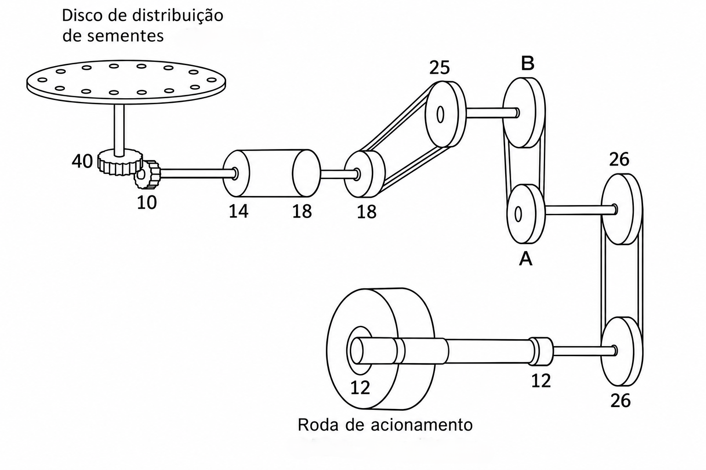

# Questão 1

Em busca de tempo para continuar a leitura do livro *A vida secreta das árvores*, um agrônomo quer regular uma semeadora para a cultura da soja e determinar quanto tempo levará para fazer a operação de semeadura. O agrônomo/pequeno produtor possui 15 hectares, dos quais 12,5 serão cultivados com soja.

<!-- ## Características -->

A semeadora do agrônomo tem largura de trabalho de 4,5 m, e ele sempre faz a semeadura a uma velocidade de 5,5 km h^-1^. No ano passado, ele fez algumas anotações sobre o tempo gasto na operação.

 - Tempo efetivo: ~303 minutos;
 - Manobras: ~70 minutos;
 - Abastecimento: ~60 minutos.

Neste ano, a ideia é ter 250 mil plantas por hectare. Para isso, ele conta com uma semeadora de 10 linhas, que tem boa distribuição, mas, devido à idade do implemento, recomenda-se adicionar 10% de sementes como margem de segurança. A semente disponível na cooperativa possui PMS de 200 g e germinação de 97%, mas apresenta 2% de impurezas devido a problemas na embalagem.

## Quantas sementes por metro o agrônomo deve observar para ter o estande de plantas desejado? Além disso, qual é a quantidade de sementes necessária para toda a área?

Para encontrar o espaçamento, basta dividir a largura de trabalho da semeadora pelo número de linhas:

$$
Distância~entre~linhas = \frac{4,5~m}{10~linhas} = 0,45~m~(45~cm)
$$

Agora, calcula-se a quantidade de metros lineares que 1 hectare tem, considerando o espaçamento de 0,45 m.

$$
Metros_{lineares} = \frac{100}{0,45}*100 = 22222.22~m~lineares
$$

Em seguida, corrigimos a população de plantas pela pureza e pela germinação.

$$
Pop_{plantas}= \frac{250000~plantas}{(0,97*0,98)} = 262991.8~plantas~ha^{-1}
$$


Mas devemos adicionar 10% como margem de segurança:

$$
Pop_{plantas}= 262991.8 * 1,10~(10\%) = 289291~plantas~ha^{-1}
$$

```{=typst}
#v(0.4em)
#destaque("Atenção", rgb("#D97706"))[No caso de aumentar em 10% a população final desejada, é necessário multiplicar o valor por 1,10, obtendo, assim, um valor acrescido de 10%. Por outro lado, ao dividir a população por 0,90 (procedimento utilizado no cálculo da germinação, por exemplo), estamos compensando uma redução de 10%, ou seja, calculando o valor inicial necessário para que, após uma perda de 10%, seja atingido o valor desejado. Portanto, não é esse o caso. Exemplo: se tenho R\$ 100,00 e quero acrescentar 10%, obtenho R\$ 110,00. Agora, se tenho R\$ 100,00 e quero que esse valor corresponda a 90% do valor final, o valor final precisa ser R\$ 111,11.]
```

Com a população corrigida e a quantidade de metros lineares de 1 hectare, podemos calcular o número de sementes a cada metro:

$$
Sementes_{m}= \frac{289291~plantas~ha^{-1}}{22222,22~m~lineares}= \mathbf{13,02~sementes~m^{-1}}
$$

Agora, podemos encontrar o número de sementes para a área total de 12,5 hectares:

$$
Sementes_{totais} = 289291* 12,5 =  \mathbf{3.616,138~sementes}
$$

## Quais são, também, as capacidades de campo teórica e efetiva, a eficiência de campo e a capacidade de manipulação? Em quanto tempo o agrônomo poderá voltar a ler seu livro?

Podemos encontrar primeiro a capacidade de campo teórica:

$$
CCE = 4,5~m * (5,5~km~h^{-1}*1000)= 24750~m^{2}~h^{-1} = \frac{24750}{10000} =  \mathbf{2,475~ha~h^{-1}}
$$

Já a capacidade de campo efetiva será:

$$
CCE = \frac{12,5~ha}{\frac{(303+70+60)}{60}}= \mathbf{1,732~ha~^{-1}}
$$

Com ambas as capacidades, é possível encontrar a eficiência:

$$
Ef = \frac{1,732~ha~^{-1}}{2,475~ha~h^{-1}} =  \mathbf{0,699~ou~ \approx70\%}
$$


Agora, vamos considerar a capacidade de campo efetiva, ou seja, o agrônomo leva cerca de uma hora para semear 1,732 hectare; logo, quanto tempo levará para semear os 12,5?

$$
Tempo_{fim}= \frac{12,5}{1,732}=  \mathbf{7.217~h}
$$

```{=typst}
#v(0.4em)
#destaque("Atenção", rgb("#D97706"))[Se for utilizada a capacidade de campo teórica, é sempre importante lembrar que ela não considera os tempos "perdidos", além do tempo gasto apenas na semeadura. Portanto, não é a mais adequada nesse caso, já que temos a capacidade de campo efetiva.]
```

Agora, usamos o PMS para encontrar o peso das sementes em 1 hectare:

$$
Peso_{1ha}= \frac{(289291*200)}{1000}= \frac{57858.2}{1000} = 57,858~kg
$$

Por fim, é possível encontrar a capacidade de manipulação.


$$
CM = \frac{4,5*(5,5*1000)*0,70}{10000}*57,858=  \mathbf{101,489~kg~h^{-1}}
$$



# Questão 2

Um agricultor deseja cultivar trigo em uma área de 42 ha. Sabe-se que a densidade de semeadura recomendada é de 125 kg ha^-1^ e a de adubo, de 400 kg ha^-1^. Para realizar o trabalho, o agricultor possui um conjunto semeadora/adubadora com as seguintes características: 13 linhas, perímetro da roda motriz que transmite os movimentos de 2,43 m e distância entre linhas de 0,17 m. Considere que a semente apresenta 95% de germinação, 98% de sobrevivência e 90% de pureza.

```{=typst}
#v(0.4em)
#destaque("Atenção", rgb("#D97706"))[Essa questão tem como problema a falta do PMS para auxiliar nos cálculos. Ainda assim, isso não impede sua resolução, mas é importante levantar esse tipo de informação ao realizar cálculos de semeadura.]
```

## Quais serão as quantidades (kg) de adubo e de sementes que deverão cair, por linha, se girarmos a roda motriz da semeadora 15 vezes? (Considere 5% de patinagem.)

Vamos considerar a patinagem primeiro. Se a roda girar 100%, ela percorre 2,43 m por giro; em 15 giros, temos:

$$
Distância_{100} = 2,43* 15 =  \mathbf{36.45~m}
$$
Com 5% de patinagem, temos:

$$
Distância_{5}= (2,43 * (1- 0,05)) * 15 =  \mathbf{34,627~m}
$$

Agora, vamos encontrar a quantidade de metros lineares, dado o espaçamento de 0,17 m:

$$
Metros_{lineares} = \frac{100}{0,17}*100 = 58823,53~m~lineares
$$
Também devemos encontrar a dose de sementes corrigida:

$$
Pop_{kg}= \frac{125}{(0,95*0,98*0.90)} =  149,182~kg~ha^{-1}
$$


E a quantidade de semente e de adubo que deve cair por metro:

$Sementes_{metro} = \frac{149,182}{58823,53}*1000=  \mathbf{2,536~g~m^{-1}}$  e $Adubo_{metro} = \frac{400}{58823,53}*1000=  \mathbf{6,8~g~m^{-1}}$

Se a roda for girada 15 vezes, considerando a patinagem, temos em cada linha a seguinte quantidade de sementes:

$$
Sementes_{total15}= 34,627 * 2,536 =  \mathbf{87,814~g}
$$

e de adubo:

$$
Adubo_{total15}= 34,627 * 6,8 =  \mathbf{235,464~g}
$$

## Se o agricultor coletar o adubo e as sementes de todas as linhas, quais serão as quantidades totais de adubo e de sementes que deverão cair? (Considerando os mesmos 15 giros da roda.)

```{=typst}
#v(0.4em)
#destaque("Atenção", rgb("#D97706"))[A questão foi montada de uma forma que gerou problemas de interpretação com a anterior. Aqui, a ideia é corrigir essa patinagem. Para não confundir, vou usar tudo com o desconto de 5% e, nesta questão, calcular apenas o montante final por linha.]
```

Para encontrar o total, basta multiplicar a quantidade de cada linha pelo número de linhas:


$$
Semente_{total}= 87,814~g * 13 =  \mathbf{1141,582~g}
$$
$$
Adubo_{total}= 235,464~g * 13 =  \mathbf{3061,032~g}
$$

## Quantos kg de sementes e de adubo este agricultor precisará comprar para adubar e semear toda a sua propriedade?

Aqui é só multiplicar a dose de sementes corrigida e a de adubo pela área:

Para sementes:

$$
Sementes_{42ha}=  149,182~kg~ha^{-1} * 42~ha =  \mathbf{6265,644~kg}
$$

Para adubo: 

$$
Sementes_{42ha}=  400~kg~ha^{-1} * 42~ha =  \mathbf{16800~kg}
$$


## Considerando que a capacidade de manipulação dessa operação é de 234,8 kg h^-1^ de sementes, qual é a velocidade de semeadura?

Essa questão, embora seja a última, deve ser resolvida antes; assim, conseguimos a velocidade para encontrar a capacidade de campo teórica. Para isso, temos a capacidade de manipulação como:

$$
234,8~kg~h^{-1}= \frac{(13*0,17)*velocidade~m~h^{-1}*0,85*149,182~kg~ha^{-1}}{10000}
$$
$$
234,8~kg~h^{-1}= \frac{*velocidade~m~h^{-1}*280,238}{10000}
$$

$$
\frac{(234,8~kg~h^{-1}*10000)}{280,238}= velocidade~m~h^{-1}
$$

$$
velocidade= \frac{8378.592}{1000}=  \mathbf{8,379~km~h^{-1}}
$$


## A eficiência da operação é de 85%. Com isso, que valor podemos estimar para a capacidade de campo efetiva?

Para encontrar a capacidade efetiva, antes precisamos da capacidade de campo teórica, calculada pela largura de trabalho (linhas e espaçamento) e pela velocidade:

$$
CCT = (13*0,17)* (8,379*1000)= \frac{18517.59}{10000}=  \mathbf{1.852~ha~h^{-1}}
$$


Já para a capacidade de campo efetiva, usamos a eficiência:

$$
0,85 = \frac{CCE}{1,852}
$$

$$
CCE = 1,852*0,85=  \mathbf{1,574~ha~h^{-1}}
$$





# Questão 3

Considere a seguinte situação: cultivo de milho, com população final de 67.000 plantas ha^-1^; espaçamento de 0,8 m; germinação de 99%; sobrevivência de 95%.

Considere também que, na regulagem da máquina, percorreram-se 50 m (portanto, nessa regulagem a semeadora não está suspensa, ou seja, está sendo regulada no solo onde será realizada a semeadura). Nessa distância, foram coletadas, em média, 213 sementes em cada linha da semeadora.

## Qual é o número desejado de sementes por metro linear?

Primeiramente, corrigimos a população desejada pela germinação e pela sobrevivência:

$$
P_s = \frac{67000}{0,99 \times 0,95}= 71238,7~\text{sementes ha}^{-1}
$$

Em um hectare, considerando o espaçamento de 0,80 m, temos:

$$
M = \frac{100*100}{0,80} = 12500\ \text{m lineares}
$$

Assim, o número desejado de sementes por metro é:

$$
S_d = \frac{71238,7}{12500} = 5.699 \approx\mathbf{5,70\ \text{sementes m}^{-1}}
$$

## Qual é o número coletado de sementes por metro linear?


Foram coletadas, em média, 213 sementes em 50 m:

$$
S_c = \frac{213}{50} =  \mathbf{4,26\ \text{sementes m}^{-1}}
$$

## Considere que a relação existente na coleta das sementes era 0,82. Qual é a relação necessária para que seja atingido o número desejado de sementes? Quais engrenagens poderiam ser utilizadas para que se atinja essa relação?

Basta fazer uma regra de três: se com uma relação de 0,82 caem 4,26 sementes, qual é a relação para cair 5,70?

$$
I_{ideal} = \frac{5,70*0,82}{4,26} = 1,097 \approx 1,1
$$


Portanto, a relação necessária é de aproximadamente 1,10. Para escolher as engrenagens, deve-se selecionar um par cuja razão entre os números de dentes produza esse valor, respeitando a convenção de cálculo da transmissão da máquina.

Podemos isolar uma engrenagem com base em outra:

$$
1,1 = \frac{x}{20} = 22
$$

Ou seja, com engrenagens de 20 e de 22 dentes, temos a relação de 1,1.

## Qual é a acurácia da operação?

A acurácia pode ser expressa em termos de previsão de acerto, ou seja, a diferença entre o observado e o previsto, dividida pelo previsto:

$$
Erro = \frac{4,26-5,7}{5,7}*100= -0,2526\approx -25,26 \%
$$

E a acurácia é a diferença entre 100% e o erro:

$$
AC = 100- 25,26 = 74,74\%
$$

Logo, temos uma distribuição com 74% de acurácia, com ~25% de sementes abaixo do necessário.

Também é possível calcular pela divisão entre as sementes observadas e as previstas:

$$
AC = \frac{4,26}{5,7}*100 = 74,74\%
$$



# Questão 4

Considere a imagem abaixo e os dados:
- Diâmetro da roda de acionamento: 0,48 m;
- Disco de distribuição: 92 furos;
- Distribuição desejada: 10 sementes por metro linear.

{fig-align="center" width="650px"}

## Qual é a relação necessária para a distribuição de 10 sementes por metro linear? Qual é o número de dentes das engrenagens A e B?

O perímetro da roda é calculado a partir do seu diâmetro:

$$
P = \pi \times 0,48 = 1.508~m
$$

Assim, a cada volta completa da roda, a semeadora percorre aproximadamente 1,508 m.

O próximo passo é encontrar quantas sementes caem em 1,508 m, já que queremos 10 sementes a cada metro:

$$
S_r = 10 \times 1,508 = 15,08~sementes~a~cada~giro
$$

Agora, dividimos a quantidade de sementes por giro da roda pelo número de furos do disco:

$$
N_d = \frac{15,08}{92} = 0,164\ \text{volta do disco por volta da roda}
$$

Assim, temos a principal relação do sistema, que é a da roda com o disco. Mas essa relação é a que buscamos; portanto, devemos descontar as reduções que as demais relações ocasionam. Fazemos isso considerando todas as relações do sistema: 

$$
I_{alvo} = \frac{12}{12}*\frac{26}{26}*\frac{A}{B}*\frac{25}{18}*\frac{18}{14}*\frac{10}{40}
$$

A relação alvo é 0,163; assim, temos:

$$
0,163 = \frac{A}{B}* 0,4464
$$

$$
\frac{A}{B} = \frac{0,163}{0,4464} = 0,365
$$

Se arbitrarmos a engrenagem B com 30 dentes, temos para A:

$$
A = 0,365*30=10.95~dentes
$$

Se substituirmos essa relação na equação de todas as relações, encontramos o valor alvo de 0,163:

$$
I_{alvo} = \frac{12}{12}*\frac{26}{26}*\frac{10,95_A}{30_B}*\frac{25}{18}*\frac{18}{14}*\frac{10}{40} = 0,163
$$



# Questão 5

Um produtor vai semear soja em uma área de 30 ha, com espaçamento entre linhas de 0,5 m. A população final desejada é de 280 mil plantas ha^-1^. A semente apresenta germinação de 90%, sobrevivência (emergência a campo) de 92%, pureza de 98% e PMS de 180 g.

## Quantas sementes por metro linear devem ser depositadas?

Primeiramente, corrigimos a população desejada pela germinação, pela sobrevivência e pela pureza:

$$
S_h = \frac{280000}{0,90 \times 0,92 \times 0,98} = 345065,6\ \text{sementes ha}^{-1}
$$

O número de metros lineares por hectare é:

$$
M = \frac{10000}{0,50} = 20000\ \text{m lineares ha}^{-1}
$$

Assim, o número de sementes por metro será:

$$
S_m = \frac{345065,6}{20000} =  17,253\ \text{sementes m}^{-1}
$$

## Qual é a dose de semeadura em kg ha^-1^?

O PMS indica que 1.000 sementes apresentam massa de 180 g. Portanto, a massa de sementes necessária por hectare será:

$$
D = \frac{345065,6 \times 180}{1000} = \frac{62111.81~g}{1000} = 62.11~kg
$$

## Qual é a quantidade total de sementes (kg) necessária para os 30 ha?

Basta multiplicar a dose de um hectare pela área total:

$$
Q = 62,11 \times 30 = 1863.3~kg
$$



# Questão 6

Uma propriedade possui 80 ha para semeadura de milho. A semeadora tem 6 linhas espaçadas em 0,9 m e trabalha a 6 km h^-1^, com eficiência de campo de 75%. O consumo médio do trator durante a operação é de 6 L h^-1^.

## Quais são as capacidades de campo teórica e efetiva (ha h^-1^)?

A teórica é:

$$
CCT = (6*0,9) * (6\ km\ h^{-1}*1000) = 32400
$$
Em hectares:

$$
CCT = \frac{32400}{10000} = 3,24~ha~h^{-1}
$$

Já para a efetiva, usamos a eficiência de 75%:

$$
0,75= \frac{CCE}{3,24}= 0,75 * 3,24 = 2,43~ha~h^{-1}
$$

## Quantas horas serão necessárias para semear toda a área? Se a jornada é de 8 h por dia, quantos dias de trabalho?

Bom, se há 80 hectares e a capacidade de campo efetiva é de 2,43 ha a cada hora, basta fazer uma regra de três e depois dividir por 8:

$$
Tempo_{total}= \frac{80*1}{2,43}= 32,92~horas
$$

Em jornadas de 8 horas:

$$
Tempo_{8}= \frac{32,92}{8} = 4,1~dias
$$

## Qual será o consumo total de combustível na operação?

Se a operação demanda 6 L a cada hora, é só multiplicar pelo número de horas:

$$
L_{combus} = 6* 32,92= 197.52~L
$$



# Questão 7

A roda motriz de uma semeadora possui 0,60 m de diâmetro. Para determinar a patinagem, o operador marcou a roda e a fez girar 20 voltas com a máquina em operação no solo, medindo uma distância percorrida de 34,5 m. O sistema de transmissão é regulado para que o disco dosador deposite 24 sementes por volta da roda motriz.

## Qual é o perímetro da roda e a distância teórica percorrida em 20 voltas?

O perímetro é o diâmetro multiplicado por pi:

$$
P_{roda} = \pi * 0,60 = 1.88~m
$$

Já a distância teórica é o perímetro multiplicado pelo número de voltas:

$$
D_{teórica}= 1,88~m * 20= 37.7~m
$$

## Qual é a patinagem (%)?

Em teoria, era esperada uma distância de 37,7 m ao girar a roda 20 vezes; no entanto, foram observados 34,5 m. Logo, a patinagem é:

$$
P_{\%}= \frac{37,7-34,5}{37,7}*100= 8,49~\%
$$

## Qual é o número de sementes por metro linear teórico (sem patinagem) e o real (com patinagem)?

Sem considerar a patinagem, a semeadora distribui 24 sementes a cada volta da roda. Portanto:

$$
S_t = \frac{24}{1,885} = 12,76\ \text{sementes m}^{-1}
$$

Considerando a distância real percorrida em 20 voltas, a quantidade total de sementes distribuídas será:

$$
S_{total} = 24 \times 20 = 480\ \text{sementes}
$$

Assim, a distribuição real por metro será:

$$
S_r = \frac{480}{34,5} = 13,91\ \text{sementes m}^{-1}
$$



# Questão 8

Na regulagem de uma semeadora de soja (espaçamento de 0,45 m), deseja-se uma população final de 300 mil plantas ha^-1^, com germinação de 85% e sobrevivência de 90%. A máquina percorreu 30 m e foram coletadas as sementes de 4 linhas, obtendo-se 520, 540, 515 e 525 sementes, respectivamente.

## Qual é o número desejado de sementes por metro linear?

Corrigimos a população desejada pela germinação e pela sobrevivência:

$$
S_h = \frac{300000}{0,85 \times 0,90} = 392156,9\ \text{sementes ha}^{-1}
$$

O número de metros lineares por hectare é:

$$
M = \frac{100}{0,45}*100 = 22222,22\ \text{m lineares ha}^{-1}
$$

Portanto, o número de sementes por metro é:

$$
S_d = \frac{392156,9}{22222,22} = 17,65\ \text{sementes m}^{-1}
$$

## Qual é o número médio coletado de sementes por metro linear?

Primeiramente, calculamos a média de sementes coletadas nas quatro linhas:

$$
\bar{x} = \frac{520+540+515+525}{4} = 525\ \text{sementes}
$$

Como a distância percorrida foi de 30 m:

$$
S_c = \frac{525}{30} = 17,50\ \text{sementes m}^{-1}
$$

## Qual é a acurácia da operação (%)? Precisa de novo ajuste?

A acurácia é calculada pela relação entre o valor coletado e o valor desejado:

$$
A = \frac{17,50}{17,65}\times 100 \approx 99,15\%
$$

O erro relativo, considerando o valor desejado como referência, será:

$$
Erro = \frac{17,50-17,65}{17,65}\times 100 \approx -0,85\%
$$

A distribuição ficou aproximadamente 0,85% abaixo do valor desejado. Portanto, a regulagem está bastante próxima do objetivo. Uma nova regulagem não é necessária; inclusive, ela poderia piorar a distribuição de sementes.

## Qual é o coeficiente de variação (%) entre as linhas?


Primeiramente, calculamos o desvio-padrão amostral das quatro coletas:

$$
s = \sqrt{\frac{\sum(x_i-\bar{x})^2}{n-1}}
$$

$$
s = \sqrt{\frac{(520-525)^2+(540-525)^2+(515-525)^2+(525-525)^2}{3}}
$$

$$
s = 10,80\ \text{sementes}
$$

O coeficiente de variação é:

$$
CV = \frac{s}{\bar{x}}\times 100
$$

$$
CV = \frac{10,80}{525}\times 100
$$

$$
CV \approx 2,06\%
$$

O baixo coeficiente de variação indica pouca dispersão entre as quantidades coletadas nas quatro linhas.



# Questão 9

Em uma área de 50 ha de milho, com espaçamento de 0,8 m, será aplicado no sulco de semeadura o formulado 08-28-16 (N-P~2~O~5~-K~2~O) na dose de 350 kg ha^-1^.

## Quantos gramas de adubo devem cair por metro linear?

Em um hectare, considerando o espaçamento de 0,80 m, temos:

$$
M = \frac{100}{0,80}*100 = 12500\ \text{m lineares ha}^{-1}
$$

A quantidade de fertilizante por metro será:

$$
Q_m = \frac{350}{12500} = 0,028\ \text{kg m}^{-1}
$$

Convertendo para gramas:

$$
Q_m = 28\ \text{g m}^{-1}
$$

## Quantos kg de adubo devem ser coletados por linha em um percurso de 100 m?

$$
Q_{100} = 28 \times 100 = 2800\ \text{g}\ ou~ 2,8~kg
$$

Portanto, deverão ser coletados 2,8 kg de fertilizante em cada linha durante um percurso de 100 m.

## Quais são as doses de N, P~2~O~5~ e K~2~O (kg ha^-1^)?

A formulação 08-28-16 indica que o fertilizante apresenta 8% de N, 28% de P~2~O~5~ e 16% de K~2~O.

**Nitrogênio:**

$$
N = 350 \times 0,08 =  28\ \text{kg ha}^{-1}
$$

**Fósforo:**

$$
P_2O_5 = 350 \times 0,28 = 98\ \text{kg ha}^{-1}
$$

**Potássio:**

$$
K_2O = 350 \times 0,16 = 56\ \text{kg ha}^{-1}
$$

## Quantos sacos de 50 kg serão necessários para toda a área?


A quantidade total de fertilizante será:

$$
Q_{total} = 350 \times 50~ha= 17500\ \text{kg}
$$
Considerando sacos de 50 kg:

$$
N_s = \frac{17500}{50} = 350\ \text{sacos}
$$

Portanto, serão necessários 17.500 kg de fertilizante, equivalentes a 350 sacos de 50 kg.



# Questão 11

Um produtor semeia feijão com dose de 60 kg ha^-1^ e espaçamento de 0,5 m. A semente tem PMS de 250 g, pureza de 98%, germinação de 90% e sobrevivência de 95%.

## Quantas sementes por hectare e por metro linear estão sendo depositadas?

O PMS indica que 1.000 sementes apresentam massa de 250 g. Portanto, a quantidade de sementes presente em 60 kg de lote comercial será:

$$
S_h = \frac{60000 \times 1000}{250} = 240000\ \text{sementes ha}^{-1}
$$

Agora, corrige-se pela germinação, pela pureza e pela sobrevivência:

$$
S_{total}= \frac{240000}{(0,98*0,90*0,95)} = 286430,4\ \text{sementes ha}^{-1}
$$

O número de metros lineares por hectare é:

$$
M = \frac{100}{0,50}*100 = 20000\ \text{m lineares ha}^{-1}
$$

Assim, a quantidade de sementes puras por metro linear será:

$$
S_m = \frac{286430.4}{20000} = 14,32\ \text{sementes m}^{-1}
$$

## Qual será a população final de plantas (plantas ha^-1^ e plantas m^-1^)?

```{=typst}
#v(0.4em)
#destaque("Atenção", rgb("#D97706"))[Essas informações já foram encontradas na questão anterior. Aqui também houve um problema de texto: a ideia era, na questão anterior, fazer o cálculo sem considerar as perdas por germinação, pureza e sobrevivência. Aqui, a ideia era calcular com a correção. No fim, poderíamos observar as diferenças.]
```

## Se o espaçamento for reduzido para 0,45 m e o produtor quiser manter o mesmo número de sementes por metro, qual será a nova dose (kg ha^-1^)?

Agora é apenas recalcular a quantidade de metros lineares e dividir a mesma população de sementes por esse valor:

$$
M = \frac{100}{0,45}*100 = 22222,22\ \text{m lineares ha}^{-1}
$$

$$
S_m = \frac{286430.4}{22222,22} = 12,89\ \text{sementes m}^{-1}
$$


